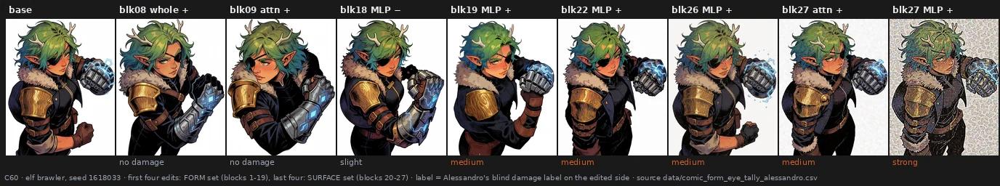

# Inside a block — attention, MLP, and what an edit costs

> **Holds** · 2120 renders · 7 prompts · pre-registered 2026-10-07
> [← all results](README.md#what-holds-and-what-does-not)

> **The direction I'm chasing.** Every block of Krea-2 has two halves, an attention and an MLP,
> and until now we had only ever scaled them together. If the knobs live at a finer grain than
> the block, the halves should do different things, and the noise that comes with a push might
> belong to one of them.
>
> **What would kill it.** The two halves doing the same thing, or the noise following the dose
> rather than the half; and, for the practical claim, middle-block edits costing as much as late
> ones once they are tried on pictures they were not chosen on.
>
> **Where we are.** The halves differ, and an eye blind to the condition puts the noise mostly in
> the MLP. Middle-block edits reshape a drawing and spare its surface far more than late ones do,
> pre-registered on new prompts. But they are not free: a few of them pay on new pictures.

## In two minutes

Each block of the model has an attention part (five matrices) and an MLP part (three). An atlas
(C59) scaled each half alone, in both directions, for all 28 blocks, on three prompts and three
seeds: 1016 renders. The person who knows the images best then labelled every block, half and
direction blind, choosing among nine kinds of artefact and three strengths.

Noise lives mostly in the MLP. The attention joins it only in the last three blocks. The first
block is the strangest: either half alone wrecks the picture, while both together keep its
composition.

The labels also showed that the edits praised as "good for the comic" were the ones that changed
the picture most, and they sat in the middle of the stack. A pre-registered test on new prompts and
seeds (C60) confirmed it: middle-block edits change more and damage less. They still cost something,
in four of ten edits.

A third test (C61) tried to overturn the older claim that every push costs fine texture. It
could not: on its own comic prompts the old numbers came back almost to the third decimal.


## The verdict

**Holds** for the practical claim, pre-registered (C60): on comic and cartoon prompts, edits to
blocks 1-19 change the picture more than edits to blocks 20-27 and damage its surface in 19% of
pairs against 79%. **Holds** that this is not free either: by the rule fixed before the labels, the
middle edits carry a detectable cost. **Open** for where the noise sits (blind, but without a
decision rule) and for the first block. **Ambiguous** for the cost of a push: page 05 replicates
on its own prompts, the test as a whole did not decide.

## Why I might be wrong

**One observer.** Every eye label is Alessandro's. He was blind to the condition, and his
self-agreement on the damage threshold was 1.00 on the 15 repeats of C60, but his eye is also the
one that chose the middle-block edits in C59. New prompts and seeds guard against fitting the
images, not against fitting a taste.

**"Slight" does not reproduce.** In both eye passes every disagreement between a first and a
repeated showing was "slight" against "none". Only medium and stronger count as damage here.

**The measures do not see the noise.** The fine-texture measure of page 05, the noise estimator of
C58 and a band-pass measure all failed against the eye on the noise that matters. As a size of
change, the same measures rank the eye's noise only moderately (AUC 0.75-0.81). A pre-registered
search for a better one (C62, eight candidates chosen on C59 and tested on C60) found none: the best
remained the size of the fine-texture change, AUC 0.79 on the test set, below its 0.85 bar
(`docs/noise_metric_result.md`). Every noise statement on this page rests on the eye.

**One dose, illustration-heavy.** All tests use ±0.35, except C61 at ±0.20. Six of seven prompts
are drawn; the only photographs are in C61, where they behaved differently.

## The data

### Where the noise sits

The split atlas pushed the attention (wq, wk, wv, gate, wo) or the MLP (gate, up, down) of one
block by ±0.35, through `granular_json`. Both checks passed to the pixel: the atlas baseline
reproduced, and all eight matrices through the granular path equalled the whole block through the
vector. Alessandro labelled 168 sheets at seed 2718281, one per block, half and sign, each showing
the same edit on the three prompts, plus 20 unannounced repeats.

68 of 168 sheets carry an artefact and 46 carry noise (blotches, grain, collapse or a regular
screen). Blocks 2, 3, 5 and 7 to 9 are clean in all six conditions. Among the 19 block-sign cells
where either half is noisy, the MLP is noisier in 13, the attention in 2, with 4 ties. At blocks 26
and 27 pushed positive both halves are noisy and the whole block is worse than either. A first
reading of mine from small thumbnails had put the block-26 noise in the attention alone; at full
resolution both halves carry it, and that reading was withdrawn (`docs/split_atlas_eye_result.md`).

### The first block

At -0.35 the attention alone posterises every picture into flat saturated colour, and on the rally
into a mosaic. The MLP alone replaces the subject. Both happen in 9 of 9 cells. Lowered together,
the composition holds (layout r 0.69-0.80), but at full resolution the surface is covered in
blotches. The two halves compensate each other for content, not for texture.

The damage also changes kind. Unbalanced, the block breaks the picture at the level of content and colour:
the attention alone pushes chroma up by 13 to 68 points and streaks the surface with rainbow fringes, the MLP
alone smooths it into a painted, screen-textured surface and replaces the subject. Balanced, it keeps the
content and the colour (chroma within 2 points) and pays in blotches. One way to read it, not tested: in the
first block the two halves write large, partly opposite contributions, so lowering one alone leaves the
other uncompensated, while lowering both keeps the balance but thins the fine detail the block adds.

### Form against surface

The labels suggested, after the fact, that the sheets praised for the comic changed the picture
more than the noisy ones (layout r 0.74 against 0.87). C60 tested it on three new prompts (two
comics, one cartoon) and three new seeds. It used ten middle-block edits chosen by rule, the praised
sheets, and ten late-block edits drawn at random from the noisy ones. 191 renders; 180 blind pairs
of edit and baseline with the side random, plus 15 repeats.



| | middle edits (blocks 1-19) | late edits (blocks 20-27) | test |
|---|---|---|---|
| layout r with the baseline, median per edit | 0.721 | 0.837 | p = 0.007 |
| change seen by eye, 0-2 | 1.59 | 0.47 | p = 0.0002 |
| damage medium or stronger, edited side | 17 / 90 | 71 / 90 | baseline sides 0 / 180 |

A preference question was dropped before any label, at Alessandro's request, as too subjective.


### What the middle costs

The middle edits are not free. By the rule fixed before the labels, a cost is present: 0.19 against
0, Newcombe 95% [0.11, 0.28]. It sits in four edits, all at medium: block 19 MLP + in 8 of 9 pairs,
block 1 attention + and block 17 whole + in 4 of 9, block 13 whole - in 1 of 9. Six edits are at 0 of 9.
At 100% the damage is not the late blocks' grain: flat areas such as a sky break into patches or
rectangles. Block 19 MLP + was clean on the prompts it was chosen on and is the most damaged here,
so the cost depends on the prompt.

A follow-up (C63, `docs/clean_six_result.md`) put the six edits that came out clean on four new
illustration prompts at three new seeds, 72 blind pairs, with two late-block edits as a positive control
(damaged in 24 of 24). Four of the 72 were damaged against none of their baselines, three of them from
block 9 attention +: too few pairs to call the six free (the interval reaches 13%) or costly (it reaches
below zero). Block 2 whole −, block 8 MLP +, block 9 whole + and block 18 MLP − are at 0 of 21 damaged
pairs across the two tests.

### The cost of a push, revisited

Notebook page 05 found, pre-registered, that pushing any block costs fine texture, more toward the
output. C61 tried to overturn the general wording. It pushed every whole block by ±0.20, page 05's
dose and path, on its two comic prompts and two photographs, at four new seeds: 913 renders. The
first render matched page 05's own file to the pixel. By its own rules the test decided nothing. The
gate, which required the bench to see the late-block cost, failed (0.989, p = 0.26). The primary,
blocks 1-22, was undecided (0.996, 95% [0.981, 1.011]).


The figure shows why. On the comic prompts both of page 05's numbers come back: 0.989 for blocks
1-22 and 0.934 for 23-27, against 0.989 and 0.932. On the photographs the last blocks add high
frequency instead (block 27: 1.27), which this measure counts as a gain. Page 05 stands on its own
ground, and its "any block" is untested beyond it. Including block 27 in the gate, a block page 05
itself called an outlier, was a weakness of the design.

### Reproducing this

```yaml
model:
  checkpoint: krea2_turbo_bf16.safetensors
  weight_dtype: default
  sha256: not recorded — the file is outside the repository
sampling:
  sampler: euler_ancestral
  steps: 9
  cfg: 1.0
  denoise: 1.0
  scheduler: simple
  resolution: 1024x1280
  vae: qwen_image_vae.safetensors
  text_encoder: qwen3vl_4b_bf16.safetensors (CLIPLoader type krea2)
tuner:
  node: ArthemyKrea2ModelTuner, after ArthemyKrea2ResetPatcher
  version: not recorded — the tuner is a separate repository
  mode: Real Value; halves through granular_json (blocks.B.attn.{wq,wk,wv,gate,wo}, blocks.B.mlp.{gate,up,down}), whole blocks through the 34-slot vectors_override in C61
prompts:
  files: [data/split_atlas_plan.csv, data/comic_form_plan.csv, data/cost_floor_plan.csv]
  ids: [P01_blacksmith, F4_closeup, S1_rally, P02, P1_elfbrawler, F1cartoon_fisherman, P4_selfie]
seeds: [2718281, 3141592, 4669201, 1618033, 1414213, 2236067, 1259921, 1732050, 2645751, 3162277]
conditions:
  - name: attention or MLP of block B, +-0.35 (C59, C60)
    dose: 0.350
    measured_D: not measured; the dose is a per-matrix gain, not a calibrated displacement
  - name: whole block B, +-0.20 (C61)
    dose: 0.200
    measured_D: not measured
outputs:
  folders: [benchmark_split_atlas, benchmark_comic_form, benchmark_cost_floor]
  manifests: [data/split_atlas_plan.csv, data/comic_form_plan.csv, data/cost_floor_plan.csv]
analysis:
  scripts: [experiments/split_atlas.py, experiments/split_atlas_eye.py, experiments/comic_form_test.py, experiments/cost_floor_test.py]
  produces: data/split_atlas_measures.csv, data/split_atlas_eye_tally_alessandro.csv, data/comic_form_eye_tally_alessandro.csv, data/comic_form_layout.csv, data/cost_floor_measures.csv
```

## Provenance

* Renders: split atlas C59 (1016), comic form C60 (191), cost floor C61 (913).
* **Pre-registrations:** `docs/prereg_comic_form_test.md` (+ amendments 1 and 2),
  `docs/prereg_cost_floor.md` (+ amendment 1), `docs/split_atlas_eye_protocol.md` (+ amendment 1);
  the atlas plan `docs/plan_split_atlas.md`; the earlier block-23 split `docs/prereg_blk23_split.md`.
* **Result documents:** `docs/split_atlas_result.md`, `docs/split_atlas_eye_result.md`,
  `docs/comic_form_result.md`, `docs/cost_floor_result.md`, `docs/blk23_split_result.md`.
* **Data:** `data/split_atlas_eye_alessandro.csv`, `data/split_atlas_eye_key.csv`,
  `data/comic_form_eye_alessandro.csv`, `data/comic_form_eye_key.csv`, `data/comic_form_layout.csv`,
  `data/cost_floor_measures.csv`, `data/cost_floor_cells_G1.csv`, `data/punto7_blocks.csv`.
* **Labels and keys** were committed in the order the protocols require: key before labels, labels
  as downloaded before any count.
