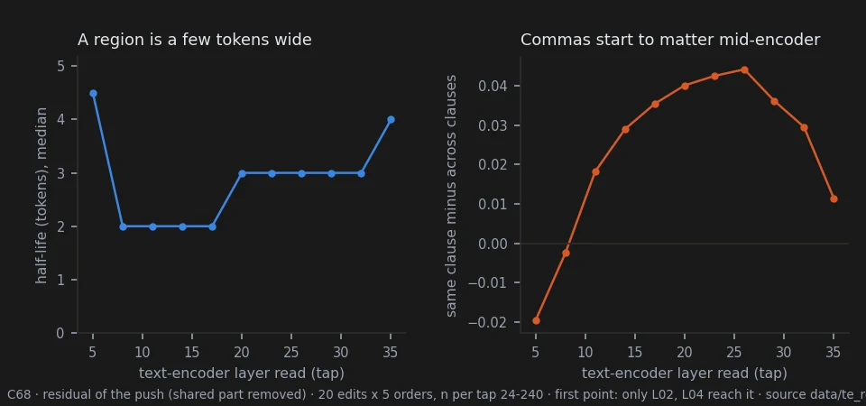
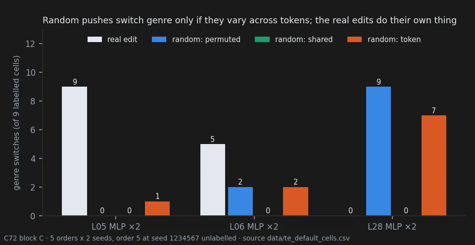
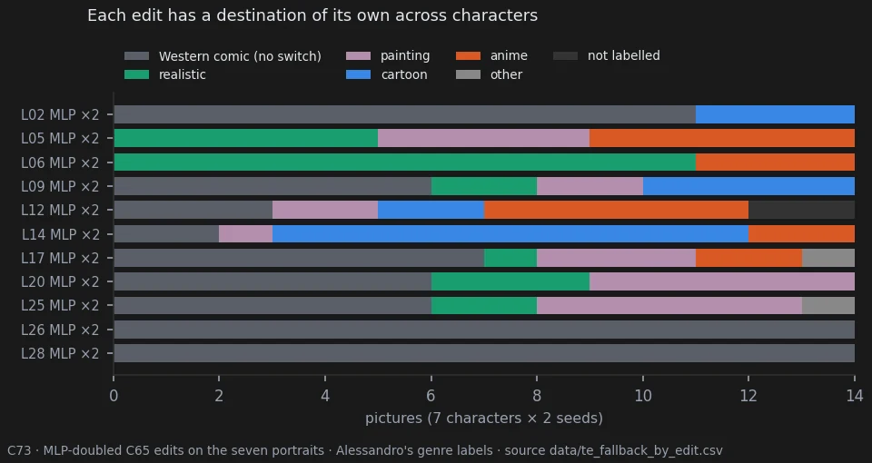

# The text encoder — how hard it pushes, and where the picture goes

> **Holds** · 1527 renders · 70 prompts · pre-registered 2026-10-12
> [← all results](README.md#what-holds-and-what-does-not)

> **The direction I'm chasing.** Krea-2 reads the prompt with a language model, Qwen3-VL-4B, before
> the image model draws anything. If the same weight edits that work on the image model work on that
> text encoder, they might change *what the picture is about* — the genre, the style — rather than
> its surface. And once the picture changes, I want to know why it goes where it goes.
>
> **What would kill it.** Edits whose effect cannot be predicted from anything we can measure on the
> text side; and, for the "why", an explanation that does not survive a test fixed before the data.
>
> **Where we are.** How *much* a picture changes is predictable from the text side alone, mostly by
> the kind of edit. *Where* it goes is now clearer: anime is this character's fallback when the style
> words stop working, shown directly by removing them — but only for the elf: other characters fall back to
> painting or realistic renders. Random pushes reach that fallback only if they
> vary from token to token, and each real edit has a direction of its own: one protects the comic, another
> drives it to anime. Why a given edit points where it does is still open. And a dose ladder showed that the
> full-strength edits do not break the picture: the style holds up to about d = 0.70, and before it moves, the
> edit has often already changed *who* is drawn.

## In two minutes

Before the image model draws, a language model reads the prompt and hands over a long list of
numbers, the **conditioning**. That's all the image model will ever know about your words. So I edited that
language model the same way I edit the image model: one layer, its attention or its MLP, zeroed or doubled.


The pictures change a lot, and in a particular way. They do not get noisy, as they do when the image
model is pushed hard. They change **genre** — a Western comic becomes anime or a cartoon — and usually
**who** is drawn: the character loses her antlers, her ears, her skin tone, often her identity. The same edit
on the same words in a different order can land in a different genre.


The useful part: **how much** a picture changes can be predicted without rendering it. Measure how
far the edit moves the conditioning, and you know roughly how far the picture will move. That held in
two tests fixed in advance — but mostly because it tells kinds of edit apart. Among the edits that
change genre, all of them large, it says little about which change more.

The puzzle: **where** the picture goes. When the elf changes genre, she goes to anime in 39 of 50 cases.
I tested two explanations. Maybe the picture stops paying attention to the words "western comics":
no. Maybe the edit pushes the text the way writing "anime" would: no, the push points somewhere else
entirely, and it is 5 to 24 times larger than swapping a style word.

Then I stopped guessing and looked at the fallback directly. Remove the three style words and the elf is drawn as anime,
every time. Anime is where *this* description goes when nothing holds it in a style. Seven other characters,
stripped of their style words, fall back to painting or realistic renders instead: there is no single
default.


Random pushes as large as the edits, with no weight touched, also reach it, but only when they vary from
token to token: the same random vector added to every token changes nothing. And the real edits are not
random: the edit with the largest push keeps the comic every time, while random pushes of its size break
it almost every time.

Last, I asked whether those edits were simply too strong. I rendered three of them at twelve doses, from a
tenth of the edit to the full one. Nothing changes style below 0.70, and no picture breaks, even at full dose. But
the character goes first. The half-orc loses her tusks, which the prompt asks for, and her ears and grey skin,
which the model had chosen, while she is still drawn as a comic; the style changes only later. For me this is the real damage: the edit makes the model forget what I asked
for, and it fills the gap with a more generic person.


## The verdict

**Holds**, pre-registered twice: the size of the push on the conditioning predicts how much the
picture changes (Spearman 0.71 and 0.80), mostly between kinds of edit; within the edits that change
genre it nearly vanishes (exploratory). **Holds**: the push is shared by the whole prompt plus small
regions of 2-4 tokens bounded by commas. **Holds**: these edits change genre and identity, with less
surface-quality loss than a DiT preset. **Overturned**: one edit moving different characters the same way; the genre switch
coming from less attention on the style words; the switch coming from a text-like push toward "anime".
**Holds**, pre-registered (C72): without its style words the elf is drawn as anime. **Holds** (C73): each
character has its own fallback, mostly painting or realistic. **Overturned** (C73): strong edits send a
character to its own fallback. **Ambiguous**:
whether random pushes of the same size reach the fallback as often as edits — yes if they vary across
tokens, no if they are one shared vector. **Open**: that each edit's own direction decides; what single
phrases draw alone; anime as the usual destination of a switch. **Ambiguous**: whether the strong edits
separate word orders inside the image model. **Holds** (C74): along a dose ladder the pictures move toward the
full-dose picture, and the style changes before coherence breaks, which it never does. **Holds\*** (C74): the change is
gradual, by the rule fixed in advance; \*but only pooled: L14 slides, L06 jumps. **Open** (C74): that the edit loses the character's
traits before its style.

## Why I might be wrong

**One observer, not blind.** Every genre and intensity label is mine. On the order grids I saw the edit
names, and I had seen these pictures before. I gave the intensity labels after I knew the first test had
failed.

**One prompt carries the word-order story.** C69, C70 and C71 rest on the elf in five word orders at
one seed. The anime default may be specific to this prompt or this character.

**The fallback rests on one character.** Anime is the fallback of *this* elf description; C73 confirmed that
other characters fall back elsewhere. In the no-style pictures the character,
pose and composition stay; what changes is the rendering — flatter cel shading, no hatching — and the
label "anime" is my reading of that change.

**Genre labels hide sub-styles, and the doses are extreme.** While labelling I noticed that each label covers
very different sub-styles: two pictures labelled "Western comic" can look nothing alike, so "no switch" does not mean
"same style". All these edits zero or double a layer half; at that strength part of what is labelled a change of
genre may be a loss of stylistic coherence. C74 checked this with a dose ladder and comparative judgements: no picture
lost coherence, up to full dose. The labels of sub-style remain mine.

**Size mostly sorts kinds of edit.** The two tests of the size of the push were fixed on all edits
together. Checked afterwards within one kind, the relation nearly vanishes for the MLP-doubled edits —
the ones that change genre — and holds at 0.46-0.66 for the others (`data/te_size_within_type.csv`). Part
of that may be a ceiling: 28 of the 35 MLP-doubled edits were already labelled strong.

**Mostly large doses.** Almost everything here is at ±1: a layer half doubled or removed. C74 adds twelve
doses, but for three edits, three characters and two seeds only.

**Traits were not a fixed list.** In C74 I wrote down which prompt traits were lost in free text, and that question
decided no test. One row has an onset of "never" although the picture changes at 0.80 (I checked); it is kept as
downloaded and changes no verdict.

**What the measures do not see.** The conditioning is what the image model receives, not what it does
with it. Attention says where a phrase is read, not what it says. C71 averages over all the tokens of a
prompt, which can hide an effect concentrated on a few words.

**The intensity scale mixed two things.** On L28 MLP doubled, all five pictures are labelled Western
comic but intensity 3, "entirely another genre". Opened next to the original, they stay comics with a
very different rendering. In practice intensity measured the overall change of style.

## The data

### The size of the push

C67 encoded the elf prompt under every edit of the C64 pilot (721 encodes, no images) and measured,
for every token and every reading the edit can reach, how far the conditioning moved. Doubling an MLP
moves it most (median 0.89), then doubling an attention (0.29), removing an MLP (0.18) and removing an
attention (0.11) — the same order in which the eye ranked the pictures. Scaling only the queries and
keys of a layer changes nothing the image model receives: a normalisation inside the attention cancels it.


| test | value | rule | verdict |
|---|---|---|---|
| C67 E1 — size against "how much it changed", 140 elf edits | Spearman 0.71; AUC 0.80 for style changed | ≥ 0.50 | supported |
| C70 G3 — size against the rate of genre switches, 20 edits | Spearman 0.73 | ≥ 0.50 | supported |
| C70 G3d — size against the mean intensity 0-3, 20 edits | Spearman 0.80 | ≥ 0.50 | supported |

These tests pooled every kind of edit, and the kinds differ a lot in size. Within one kind the picture is
different (exploratory, `data/te_size_within_type.csv`): attention doubled 0.66, MLP zeroed 0.65, attention
zeroed 0.46 on the C67 material, but MLP doubled 0.06 (n 35). On the C70 material the MLP-doubled edits give
0.36 (n 11, p 0.28). So the size of the push tells a strong kind of edit from a mild one; among the strong
ones, the ones that change genre, it does not say which changes the picture more.

### A shared push made of small regions

An exploratory analysis of C67 found that each edit pushes the conditioning of very different prompts
in nearly the same direction (cosine 0.91-0.99 between prompts, 0.55 between different edits). C68 took
away that shared push and looked at what was left. Two neighbouring tokens are pushed in related
directions; four or five tokens apart the relation has halved (half-life 3 tokens). Groups follow the
commas, most clearly in the middle of the encoder. These regions are as stable across word orders as
the shared push, so they do not explain why word order matters (C68 H3, Spearman -0.37, not supported).



### Genre and identity, not surface

The C64 pilot doubled or removed each half of each of the 35 layers the image model reads, on the elf,
and I labelled every picture blind (140 edits, 10 repeats). Doubling changes far more than
removing: strong changes in 40 of 70 against 4 of 70. Surface damage is rare (medium or strong in 8 of
140). My notes describe genres more often than noise: anime, chibi, a 1990s cartoon, children's
illustration. C65 confirmed the quality side on seven characters: BRISQUE improves slightly (-1.52)
where the DiT preset of page 28 costs +8.09.

### No common direction across characters

C65 applied 20 edits chosen from the pilot to seven fantasy characters at two seeds. A DiT preset moves them
the same way (page 28); these edits do not. Only 4 of 20 were coherent across characters (the bar was
14). The eye and the statistics disagreed in a telling way: the strong edits shift every picture the
same way in colour and contrast, but each character lands in a different genre. At ±1 these edits also
change who is drawn: identity is kept for at most two eligible characters in 19 of 20 edits.


The figure also shows that the destination depends on the character. On these portraits L06 MLP doubled
turns the dwarf and the gnome into photographs, not anime; on the elf (below) the same edit scatters the word
orders between comic, anime and cartoon. Anime is the elf's fallback, not every character's.

### Where the switches go

In C70 I named the genre of each of the 105 pictures of the word-order test (seed
3141592) and, separately, how far each one moved from its original (0-3). The five originals are all
Western comic, so word order alone does not change the genre. Of the 100 edited pictures, 50 changed
genre: **39 to anime**, 11 to cartoon, none to realistic or painting. No edit that zeroes a layer half
changed the genre. Two patterns appear among those that do. L05, L20 and L25 MLP doubled send all five
orders to anime. L06, L09, L12 and L14 MLP doubled scatter them across genres; these are the edits he
had scored highest for word-order dependence.


### Inside the image model

C69 re-rendered 25 pictures — the elf in five orders, the original and four edits — with a probe that
only reads the image model's attention. All 25 came out identical to the originals, pixel for pixel. At
every step and in every block, the probe recorded where each part of the picture looks among the phrases
of the prompt.


The strong edits move these maps about twice as much as the mild ones (P4: 0.29 and 0.30 against 0.16
and 0.13). Whether they also make the five orders read the prompt in more different places is not
settled. P1 passed by a margin of 0.003, carried by L12 alone; L06 does not do it, though its pictures
diverge as much. The blocks where L12 raises the divergence most are 12, 25, 18, 15 and 16.

### Not less attention on the style words

The first explanation for the genre switch: weaken the words that name the style, and the model's own
taste takes over. L06 MLP doubled does cut the attention on the three style phrases, from 0.095 to
0.054 of all attention on text, in every order. But L12 MLP doubled raises it to 0.121 and switches
genre just as often. Picture by picture, the share does not separate the pictures that switched from
those that did not.


| test | value | rule | verdict |
|---|---|---|---|
| C69 P5 — strong edits lower the style share more than mild ones | L06 -0.041, L12 +0.026, L10 -0.020, L19 +0.005 | max(strong) < min(mild) | not supported |
| C70 G1 — share lower in switched pictures (20) | AUC 0.46 | ≥ 0.70 | not supported |
| C70 G1d — share against intensity (20) | Spearman +0.05 | ≤ -0.40 | not supported |

### Not a text-like push

The second explanation: the edit moves the conditioning the way the words "anime style" would. C71
encoded the five orders with "realistic western comics style" replaced by "anime style", "cartoon
style" or "oil painting style", and compared the direction of each swap with the push of each edit.
Nothing lines up: every cosine is between -0.12 and +0.07. The three edits that send every order to
anime point, if anywhere, slightly *away* from it. The pushes are 5 to 24 times larger than the word swap
(exploratory). The only hint of a direction is cartoon: the cartoon-minus-painting cosine follows the
number of cartoon pictures (Spearman 0.52, reported, counts of at most 3).


### The fallback is anime

C72 asked what the picture becomes when nothing names a style. The elf prompt was rendered in its five word
orders at two seeds without "realistic western comics style", "bold ink outlines" and "hatched shadows".
Every labelled picture is anime: 9 of 9, against a bar of 7 of 10 fixed before the labels (one picture was not
labelled; the result holds whatever it is). With the style words, the same orders and seeds are Western comic in
9 of 9. The empty prompt is not anime (anime, realistic, anime, painting), so this is not the model's global
default. It is what this description of a character becomes when the style words are gone.

### Random pushes of the same size

C72 then added to the plain conditioning random pushes as large as the real push of three edits, tap by tap,
with no weight edited. The edits were L05 (all orders to anime), L06 (orders scattered) and L28 (largest push,
stays comic). A gate checked the instrument first: with no push the render is pixel-identical to the plain one,
and passing the real edit's conditioning through gives exactly the edit's render. A first version of the gate,
built on stored float16 encodes, failed and was replaced before any other render (amendment 1).


| push | genre switches (27 labelled cells) | ratio to the real edits | rule |
|---|---|---|---|
| real edits | 14 | — | — |
| random, permuted channels | 11 | 0.79 | size alone suffices |
| random, one vector for all tokens | 0 | 0.00 | the direction matters |
| random, noise per token | 10 | 0.71 | size alone suffices |

By the rule fixed before the labels (amendment 2), the variants disagree, so the answer is "depends on the form
of the push". Random pushes that vary from token to token reach the fallback, mostly anime (15 of 21 switches);
a shift shared by every token, as large, does nothing to the genre. Edit by edit, the real pushes are not like
random ones. L28's random pushes switch 16 of 18 pictures, yet the real L28 edit keeps all 9 a Western comic.
L05's random pushes switch 1 of 18, yet the real L05 edit turns all 9 anime.



So size alone does not decide where a strong edit goes; each edit's direction does, and why each points where
it does is not known. One untested reason a shared shift may be harmless: the image model's text path normalises
what it receives, which could absorb an offset common to every token.

### Every character has its own fallback

C73 repeated the no-style test on the seven portraits of page 28 and C65, removing only "Western comics style"
from their frame, at four seeds. With the clause all 28 pictures are Western comic; without it, the same faces
and costumes come back as paintings or realistic renders, and only one picture of 28 is anime. The fallback
depends on the character (pre-registered H1, supported).


Do the edits lead each character to that fallback? No (H2, not supported): switched pictures land on the
character's own fallback 0.28 of the time, as often as chance (0.27). What they show instead is a destination
per edit, across characters: L06 MLP doubled gives realistic renders, L14 cartoons, L26 and L28 leave the comic
alone, others spread. Elves bend several edits toward anime: the elf rogue, whose own fallback is painting,
switches to anime in 10 of its 12 switched pictures.



### What each phrase draws alone

The same pass rendered each of the 36 phrases of the elf prompt alone, plus a few words, at four seeds.
Described, not tested:
* **"female dwarf"** is drawn as a woman **with a beard** in 4 of 4, and so is the full dwarf prompt. The beard that
  appears on the dwarf under edits is the model's own picture of a dwarf, not something the edit invents.
* **"uniform"** is an anime girl in a school uniform in 4 of 4.
* **"realistic western comics style"** alone draws bearded cowboys in comic panels: the model reads "western" as the
  genre of the American West.
* **The elf's description** ("female antlered elf brawler") is anime in 3 of 4.
* **Phrases without a person** are mostly drawn as realistic photographs (78 of 165 labelled single-phrase
  pictures).


### A dose ladder

C74 rendered three MLP edits at twelve doses (0.10 to 1.00) on three portraits at two seeds: L06 (to realistic),
L14 (to cartoon) and L28 (keeps the comic, the control). The full-dose render was re-made first and is
pixel-identical to the C65 one. For each strip I answered, side by side, where the style starts to differ, whether
it moves gradually or in a step, whether the intermediate pictures head toward the full-dose one, where the picture
loses coherence and where it loses a trait the prompt asks for. Before labelling I fixed the definitions
(amendment 2): a hybrid that reads as one intended style, such as comic lines with painted textures, is a change of
style, not a loss of coherence.

| test (L06 and L14, 11 changing strips) | value | rule | verdict |
|---|---|---|---|
| H1 — gradual rather than a step | 8 of 11 = 0.73 | ≥ 0.6 | gradual\* (pooled) |
| H2 — intermediate doses head toward the full dose | 10 of 11 = 0.91 | ≥ 0.7 | supported |
| H3 — style changes before coherence is lost | 11 of 11 | ≥ 2/3 | supported |

\*The pooled H1 hides two behaviours. L14 slides toward cartoon in 6 of 6 strips. L06 jumps from comic to photograph
around 0.80 in 4 of 5. And H3 is met in the simplest way: I marked no loss of coherence anywhere.


What the ladder shows beyond the tests (reported, not tested):

* **The style holds for most of the range.** No strip changes style below 0.70. Since the edit scales three matrices
  of the MLP, the layer's output at 0.70 is, by my estimate of (1 + d)³, already several times the original.
* **The character goes first.** In L06 and L14, a trait the prompt asks for is lost before the style changes in 5
  of 10 strips and at the same dose in 2. "Trait" here mixes two things my notes did not separate: features the
  prompt asks for (the half-orc's tusks, the dwarf's copper hair) and features of the original picture the prompt
  does not name (skin tone, ears). The L28 control never changes style, yet loses traits in 4 of 6 strips:
  the elf's face turns green, the half-orc gets a high oriental collar. The changes lean one way: tusks, pointed
  ears and grey or dark skin give way to a lighter-skinned, more generic human. The prompts name no skin tone, so
  the skin is a drift from the original picture, not a failure to follow the prompt.
* **Composition moves smoothly.** In all 18 strips pose and framing change little from one dose to the next, even
  where the style jumps.

### Reproducing this

```yaml
model:
  checkpoint: krea2_turbo_bf16.safetensors
  weight_dtype: default
  sha256: not recorded — the file is outside the repository
sampling:
  sampler: euler_ancestral
  steps: 9
  cfg: 1.0
  denoise: 1.0
  scheduler: simple
  resolution: 1024x1280
  vae: qwen_image_vae.safetensors
  text_encoder: qwen3vl_4b_bf16.safetensors (CLIPLoader type krea2)
tuner:
  node: ArthemyKrea2CLIPTuner
  version: not recorded — the tuner is a separate repository
  mode: Real Value; one layer half through granular_json (layers.L.self_attn.{q,k,v,o}_proj.weight or layers.L.mlp.{gate,up,down}_proj.weight), weight x (1 + d)
prompts:
  files: [data/te_pilot_plan.csv, data/te_characters_plan.csv, data/te_bridge_plan.csv, data/te_default_plan.csv, data/te_fallback_plan.csv, data/te_dose_plan.csv]
  ids: [P1_elfbrawler, V1_Original, V2_SubjectFirst, V3_BGFirst, V4_ActionFirst, V5_Inverse, D1_dwarf_paladin, D1W_dwarf_paladin_watercolor, E2_elf_rogue, G5_gnome_wizard, H3_halfling_druid, O4_halforc_fighter, R6_dragonborn_cleric, T7_tiefling_bard, "V1-V5 without the style clauses (C72)", EMPTY, W00-W42 (C72 single phrases), "the seven portraits without 'Western comics style' (C73)"]
seeds: [1618033, 1234567, 2645751, 3141592, 3316624, 2718281, 3605551, 4123105]
conditions:
  - name: one layer half of the text encoder, d = -1.00 (zeroed) or +1.00 (doubled); C64 also at ±0.10 and ±0.35
    dose: 1.000
    measured_D: not measured; the dose is a per-matrix gain, not a calibrated displacement
  - name: C74 dose ladder, MLP of L06, L14, L28 at d = 0.10, 0.25, 0.40, 0.50, 0.60, 0.70, 0.75, 0.80, 0.85, 0.90, 0.95, 1.00
    dose: 0.10-1.00
    measured_D: not measured; the dose is a per-matrix gain, not a calibrated displacement
outputs:
  folders: [benchmark_te_pilot, benchmark_te_characters, benchmark_te_bridge, benchmark_te_default, benchmark_te_fallback, benchmark_te_dose]
  manifests: [data/te_pilot_plan.csv, data/te_characters_plan.csv, data/te_bridge_plan.csv, data/te_default_plan.csv, data/te_fallback_plan.csv, data/te_dose_plan.csv]
  encodes_without_images: [benchmark_te_conditioning (C67, 721), benchmark_te_regions (C68, 241), benchmark_te_direction (C71, 16)]
analysis:
  scripts: [experiments/te_pilot_phase1_tally.py, experiments/te_characters.py, experiments/te_conditioning.py, experiments/te_regions.py, experiments/te_bridge.py, experiments/te_genre_tally.py, experiments/te_genre_dose_tally.py, experiments/te_direction.py, experiments/te_size_within_type.py, experiments/te_default.py, experiments/te_default_tally.py, experiments/te_fallback.py, experiments/te_fallback_tally.py, experiments/te_dose.py, experiments/te_dose_tally.py]
  produces: data/te_conditioning_tests.csv, data/te_regions_tests.csv, data/te_bridge_readings.csv, data/te_bridge_style.csv, data/te_genre_tests.csv, data/te_genre_dose_tests.csv, data/te_direction_tests.csv, data/te_dose_tests.csv
```

## Provenance

* Renders: C64 pilot (463), C65 characters (531), C69 bridge (25), C72 defaults (280), C73 fallbacks (29), C74 dose ladder (199, gate included).
* Encodes without images: C67 (721), C68 (241), C71 (16).
* **Pre-registrations:** `docs/prereg_te_characters.md` (+ amendments 1-3), `docs/prereg_te_conditioning.md`
  (+ amendments 1-2), `docs/prereg_te_regions.md`, `docs/prereg_te_bridge.md`, `docs/prereg_te_genre.md`
  (+ amendments 1-2), `docs/prereg_te_direction.md`, `docs/prereg_te_default.md` (+ amendments 1-2), `docs/prereg_te_fallback.md`, `docs/prereg_te_dose.md` (+ amendments 1-2); the pilot plan `docs/plan_te_pilot.md`.
* **Result documents:** `docs/te_pilot_phase1_result.md`, `docs/te_characters_result.md`,
  `docs/te_characters_eye_result.md`, `docs/te_order_grid_result.md`, `docs/te_conditioning_result.md`,
  `docs/te_regions_result.md`, `docs/te_bridge_result.md`, `docs/te_genre_result.md`,
  `docs/te_direction_result.md`, `docs/te_default_result.md`, `docs/te_fallback_result.md`, `docs/te_dose_result.md`.
* **Data:** `data/te_pilot_eye_alessandro_phase1.csv`, `data/te_order_grid_notes_alessandro.csv`,
  `data/te_order_tests.csv`, `data/te_size_within_type.csv`, `data/te_genre_alessandro.csv`, `data/te_genre_dose_alessandro.csv`,
  `data/te_bridge_style.csv`, `data/te_direction_by_edit.csv`, `data/te_direction_norms.csv`,
  `data/te_default_genre_alessandro.csv`, `data/te_default_cells.csv`, `data/te_default_tests.csv`,
  `data/te_words_alessandro.csv`, `data/te_massive_channels.csv`, `data/te_fallback_genre_alessandro.csv`,
  `data/te_fallback_tests.csv`, `data/te_fallback_by_edit.csv`, `data/te_dose_alessandro.csv`, `data/te_dose_tests.csv`.
* **Labels and keys** were committed in the order the protocols require: key before labels, labels as
  downloaded before any count.
* **Probes:** `tools/comfyui_krea2_probe` (conditioning), `tools/comfyui_krea2_attnprobe` (attention; reads
  only, checked pixel-identical on all 25 renders), `tools/comfyui_krea2_condpush` (random pushes; gate
  pixel-identical).
