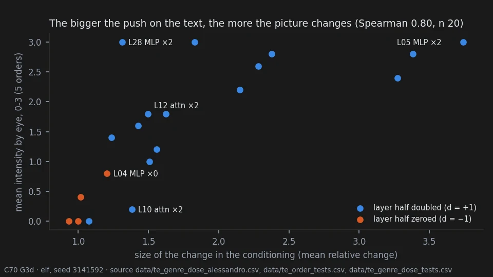

# The text encoder — how hard it pushes, and where the picture goes

> **Holds** · 1019 renders · 14 prompts · pre-registered 2026-10-12
> [← all results](README.md#what-holds-and-what-does-not)

> **The direction I'm chasing.** Krea-2 reads the prompt with a language model, Qwen3-VL-4B, before
> the image model draws anything. If the same weight edits that work on the image model work on that
> text encoder, they might change *what the picture is about* — the genre, the style — rather than
> its surface. And once the picture changes, I want to know why it goes where it goes.
>
> **What would kill it.** Edits whose effect cannot be predicted from anything we can measure on the
> text side; and, for the "why", an explanation that does not survive a test fixed before the data.
>
> **Where we are.** How *much* a picture changes is predictable from the text side alone. *Where* it
> goes — very often anime — is not explained by anything we have measured. Two natural explanations
> were tested and failed.

## In two minutes

Before the image model draws, a language model reads the prompt and hands over a long list of
numbers, the **conditioning**. We edited that language model the same way we edit the image model:
one layer, its attention or its MLP, zeroed or doubled.


The pictures change a lot, and in a particular way. They do not get noisy, as they do when the image
model is pushed hard. They change **genre**: a Western comic becomes anime or a cartoon. The same edit
on the same words in a different order can land in a different genre.


The useful part: **how much** a picture changes can be predicted without rendering it. Measure how
far the edit moves the conditioning, and you know roughly how far the picture will move. That held in
two tests fixed in advance.

The puzzle: **where** the picture goes. When the genre changes, it goes to anime in 39 of 50 cases.
We tested two explanations. Maybe the picture stops paying attention to the words "western comics":
no. Maybe the edit pushes the text the way writing "anime" would: no, the push points somewhere else
entirely, and it is 5 to 24 times larger than swapping a style word. One reading that fits, not yet
tested: the edit pushes the conditioning far from anything a normal prompt produces, and the image
model falls back on its own default style.

## The verdict

**Holds**, pre-registered twice: the size of the push on the conditioning predicts how much the
picture changes (Spearman 0.71 and 0.80). **Holds**: the push is shared by the whole prompt plus small
regions of 2-4 tokens bounded by commas. **Holds**: these edits change genre with less quality loss
than a DiT preset. **Overturned**: one edit moving different characters the same way; the genre switch
coming from less attention on the style words; the switch coming from a text-like push toward "anime".
**Open**: anime as the default destination. **Ambiguous**: whether the strong edits separate word
orders inside the image model.

## Why I might be wrong

**One observer, not blind.** Every genre and intensity label is Alessandro's. On the order grids he
saw the edit names, and he had seen these pictures before. The intensity labels were given after he
knew the first test had failed.

**One prompt carries the word-order story.** C69, C70 and C71 rest on the elf in five word orders at
one seed. The anime default may be specific to this prompt or this character.

**Large doses only.** Almost everything here is at ±1: a layer half doubled or removed. These are
blunt edits; what milder doses do is mostly unknown.

**What the measures do not see.** The conditioning is what the image model receives, not what it does
with it. Attention says where a phrase is read, not what it says. C71 averages over all the tokens of a
prompt, which can hide an effect concentrated on a few words.

**The intensity scale mixed two things.** On L28 MLP doubled, all five pictures are labelled Western
comic but intensity 3, "entirely another genre". Opened next to the original, they stay comics with a
very different rendering. In practice intensity measured the overall change of style.

## The data

### The size of the push

C67 encoded the elf prompt under every edit of the C64 pilot (721 encodes, no images) and measured,
for every token and every reading the edit can reach, how far the conditioning moved. Doubling an MLP
moves it most (median 0.89), then doubling an attention (0.29), removing an MLP (0.18) and removing an
attention (0.11) — the same order in which the eye ranked the pictures. Scaling only the queries and
keys of a layer changes nothing the image model receives: a normalisation inside the attention cancels it.



| test | value | rule | verdict |
|---|---|---|---|
| C67 E1 — size against "how much it changed", 140 elf edits | Spearman 0.71; AUC 0.80 for style changed | ≥ 0.50 | supported |
| C70 G3 — size against the rate of genre switches, 20 edits | Spearman 0.73 | ≥ 0.50 | supported |
| C70 G3d — size against the mean intensity 0-3, 20 edits | Spearman 0.80 | ≥ 0.50 | supported |

### A shared push made of small regions

An exploratory analysis of C67 found that each edit pushes the conditioning of very different prompts
in nearly the same direction (cosine 0.91-0.99 between prompts, 0.55 between different edits). C68 took
away that shared push and looked at what was left. Two neighbouring tokens are pushed in related
directions; four or five tokens apart the relation has halved (half-life 3 tokens). Groups follow the
commas, most clearly in the middle of the encoder. These regions are as stable across word orders as
the shared push, so they do not explain why word order matters (C68 H3, Spearman -0.37, not supported).

### Style, not damage

The C64 pilot doubled or removed each half of each of the 35 layers the image model reads, on the elf,
and Alessandro labelled every picture blind (140 edits, 10 repeats). Doubling changes far more than
removing: strong changes in 40 of 70 against 4 of 70. Surface damage is rare (medium or strong in 8 of
140). His notes describe genres more often than noise: anime, chibi, a 1990s cartoon, children's
illustration. C65 confirmed the quality side on seven characters: BRISQUE improves slightly (-1.52)
where the DiT preset of page 28 costs +8.09.

### No common direction across characters

C65 applied 20 edits chosen from the pilot to seven fantasy characters at two seeds. A DiT preset moves them
the same way (page 28); these edits do not. Only 4 of 20 were coherent across characters (the bar was
14). The eye and the statistics disagreed in a telling way: the strong edits shift every picture the
same way in colour and contrast, but each character lands in a different genre. At ±1 these edits also
change who is drawn: identity is kept for at most two eligible characters in 19 of 20 edits.

### The default is anime

C70 asked Alessandro to name the genre of each of the 105 pictures of the word-order test (seed
3141592) and, separately, how far each moved from its original (0-3). The five originals are all
Western comic, so word order alone does not change the genre. Of the 100 edited pictures, 50 changed
genre: **39 to anime**, 11 to cartoon, none to realistic or painting. No edit that zeroes a layer half
changed the genre. Two patterns appear among those that do. L05, L20 and L25 MLP doubled send all five
orders to anime. L06, L09, L12 and L14 MLP doubled scatter them across genres; these are the edits he
had scored highest for word-order dependence.

### Inside the image model

C69 re-rendered 25 pictures — the elf in five orders, the original and four edits — with a probe that
only reads the image model's attention. All 25 came out identical to the originals, pixel for pixel. At
every step and in every block, the probe recorded where each part of the picture looks among the phrases
of the prompt.


The strong edits move these maps about twice as much as the mild ones (P4: 0.29 and 0.30 against 0.16
and 0.13). Whether they also make the five orders read the prompt in more different places is not
settled. P1 passed by a margin of 0.003, carried by L12 alone; L06 does not do it, though its pictures
diverge as much. The blocks where L12 raises the divergence most are 12, 25, 18, 15 and 16.

### Not less attention on the style words

The first explanation for the genre switch: weaken the words that name the style, and the model's own
taste takes over. L06 MLP doubled does cut the attention on the three style phrases, from 0.095 to
0.054 of all attention on text, in every order. But L12 MLP doubled raises it to 0.121 and switches
genre just as often. Picture by picture, the share does not separate the pictures that switched from
those that did not.


| test | value | rule | verdict |
|---|---|---|---|
| C69 P5 — strong edits lower the style share more than mild ones | L06 -0.041, L12 +0.026, L10 -0.020, L19 +0.005 | max(strong) < min(mild) | not supported |
| C70 G1 — share lower in switched pictures (20) | AUC 0.46 | ≥ 0.70 | not supported |
| C70 G1d — share against intensity (20) | Spearman +0.05 | ≤ -0.40 | not supported |

### Not a text-like push

The second explanation: the edit moves the conditioning the way the words "anime style" would. C71
encoded the five orders with "realistic western comics style" replaced by "anime style", "cartoon
style" or "oil painting style", and compared the direction of each swap with the push of each edit.
Nothing lines up: every cosine is between -0.12 and +0.07. The three edits that send every order to
anime point, if anywhere, slightly *away* from it. The pushes are 5 to 24 times larger than the word swap
(exploratory). The only hint of a direction is cartoon: the cartoon-minus-painting cosine follows the
number of cartoon pictures (Spearman 0.52, reported, counts of at most 3).


One reading fits most of this: the edits move the conditioning far from where normal prompts sit, and
the further they go, the more the image model falls back on its default for an illustration. It has
clear exceptions. L28 MLP doubled has the largest push and stays a comic, though its rendering changes
completely. L12 attention doubled has a small one and goes to anime four times in five. The test that
would decide it — random pushes of the same size, with no weight edited — has not been run.

### Reproducing this

```yaml
model:
  checkpoint: krea2_turbo_bf16.safetensors
  weight_dtype: default
  sha256: not recorded — the file is outside the repository
sampling:
  sampler: euler_ancestral
  steps: 9
  cfg: 1.0
  denoise: 1.0
  scheduler: simple
  resolution: 1024x1280
  vae: qwen_image_vae.safetensors
  text_encoder: qwen3vl_4b_bf16.safetensors (CLIPLoader type krea2)
tuner:
  node: ArthemyKrea2CLIPTuner
  version: not recorded — the tuner is a separate repository
  mode: Real Value; one layer half through granular_json (layers.L.self_attn.{q,k,v,o}_proj.weight or layers.L.mlp.{gate,up,down}_proj.weight), weight x (1 + d)
prompts:
  files: [data/te_pilot_plan.csv, data/te_characters_plan.csv, data/te_bridge_plan.csv]
  ids: [P1_elfbrawler, V1_Original, V2_SubjectFirst, V3_BGFirst, V4_ActionFirst, V5_Inverse, D1_dwarf_paladin, D1W_dwarf_paladin_watercolor, E2_elf_rogue, G5_gnome_wizard, H3_halfling_druid, O4_halforc_fighter, R6_dragonborn_cleric, T7_tiefling_bard]
seeds: [1618033, 1234567, 2645751, 3141592, 3316624]
conditions:
  - name: one layer half of the text encoder, d = -1.00 (zeroed) or +1.00 (doubled); C64 also at ±0.10 and ±0.35
    dose: 1.000
    measured_D: not measured; the dose is a per-matrix gain, not a calibrated displacement
outputs:
  folders: [benchmark_te_pilot, benchmark_te_characters, benchmark_te_bridge]
  manifests: [data/te_pilot_plan.csv, data/te_characters_plan.csv, data/te_bridge_plan.csv]
  encodes_without_images: [benchmark_te_conditioning (C67, 721), benchmark_te_regions (C68, 241), benchmark_te_direction (C71, 16)]
analysis:
  scripts: [experiments/te_pilot_phase1_tally.py, experiments/te_characters.py, experiments/te_conditioning.py, experiments/te_regions.py, experiments/te_bridge.py, experiments/te_genre_tally.py, experiments/te_genre_dose_tally.py, experiments/te_direction.py]
  produces: data/te_conditioning_tests.csv, data/te_regions_tests.csv, data/te_bridge_readings.csv, data/te_bridge_style.csv, data/te_genre_tests.csv, data/te_genre_dose_tests.csv, data/te_direction_tests.csv
```

## Provenance

* Renders: C64 pilot (463), C65 characters (531), C69 bridge (25).
* Encodes without images: C67 (721), C68 (241), C71 (16).
* **Pre-registrations:** `docs/prereg_te_characters.md` (+ amendments 1-3), `docs/prereg_te_conditioning.md`
  (+ amendments 1-2), `docs/prereg_te_regions.md`, `docs/prereg_te_bridge.md`, `docs/prereg_te_genre.md`
  (+ amendments 1-2), `docs/prereg_te_direction.md`; the pilot plan `docs/plan_te_pilot.md`.
* **Result documents:** `docs/te_pilot_phase1_result.md`, `docs/te_characters_result.md`,
  `docs/te_characters_eye_result.md`, `docs/te_order_grid_result.md`, `docs/te_conditioning_result.md`,
  `docs/te_regions_result.md`, `docs/te_bridge_result.md`, `docs/te_genre_result.md`,
  `docs/te_direction_result.md`.
* **Data:** `data/te_pilot_eye_alessandro_phase1.csv`, `data/te_order_grid_notes_alessandro.csv`,
  `data/te_order_tests.csv`, `data/te_genre_alessandro.csv`, `data/te_genre_dose_alessandro.csv`,
  `data/te_bridge_style.csv`, `data/te_direction_by_edit.csv`, `data/te_direction_norms.csv`.
* **Labels and keys** were committed in the order the protocols require: key before labels, labels as
  downloaded before any count.
* **Probes:** `tools/comfyui_krea2_probe` (conditioning), `tools/comfyui_krea2_attnprobe` (attention; reads
  only, checked pixel-identical on all 25 renders).
