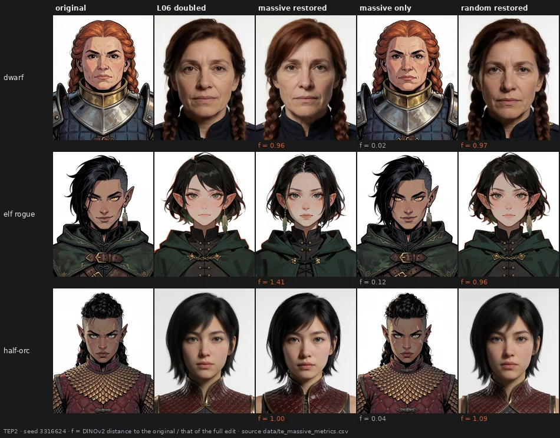
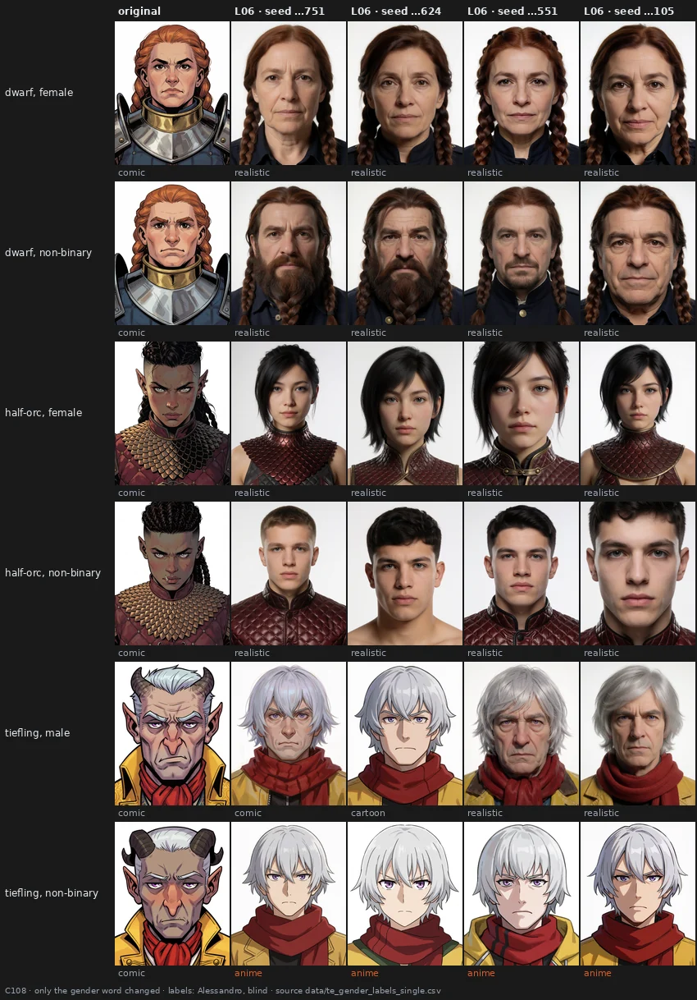
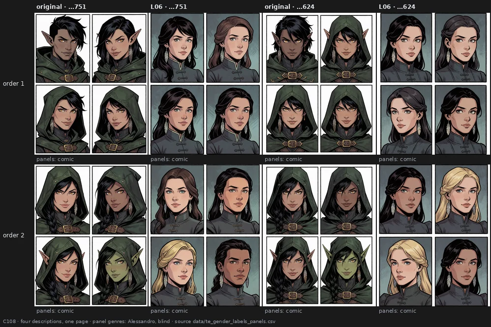

# What a text-encoder edit leaves — a curve, a signature, a family resemblance

> **Holds** · 961 renders · 29 prompts · pre-registered 2026-10-20
> [← all results](README.md#what-holds-and-what-does-not)

> **The direction I'm chasing.** Page 30 showed that an edit of the text encoder changes *what* the picture is, not
> its surface. If that's going to be a tool, an edit has to be a knob: something with a shape I can calibrate, that
> does the same thing every time I turn it, and that I could recognise by its look. I also suspected that *any* fixed
> change of the weights, even a random one, would behave like that.
>
> **What would kill it.** An edit whose push changes shape from prompt to prompt; pictures that the eye cannot sort by
> the edit that made them better than chance; a change that stays with one subject and does not carry to another.
>
> **Where we are.** An edit is a knob with a recognisable look: I sorted pictures by the edit that made them in 20 of 28
> trials, where chance gives one in 15. Across subjects the look carries as a family resemblance, not the same change,
> and that verdict leans on an answer, "something similar", that I asked for in the middle of the blind pass. And the
> embeddings that were meant to measure "the same change" for me turned out not to see it. *Where* the style goes is
> less tidy: on one description a single gender word decided it, and on other characters and in short prompts it
> didn't.

## In two minutes

I started from the conditioning, the list of numbers the text encoder hands to the image model. When I turn up an
edit, the conditioning moves. I followed that movement step by step, from a tiny dose to ten times the full one, and
asked what shape it draws. A spiral? A wave? A straight line? None of them: one bend near the start, then a straight
run. A random push of the same size at the same place bends too, so the bend belongs to the network. But how *much*
it bends belongs to the edit: on six very different prompts, a comic portrait, a rally car, a dreamlike canoe, a comic
page, a cartoon still life and a macro leaf, each edit's curve changes by at most 7 degrees. One curve per edit, any
prompt.

Then I drew that curve for all 35 layers. The deeper the layer, the less it bends. In the first third of the encoder an
edit bends exactly like a random push: there it carries no direction of its own beyond the network's. From the middle
on it is straighter than chance, and more so with depth.


Next, a suspicion about L06, the edit that turns my comic portraits into photographs. Layer 6 is where the encoder's
internal signal jumps in size, the signature of a few enormous entries, the so-called massive activations. Is the
damage carried by them? I put those 36 entries back to their original value and left the rest of the edit in place: the damage stays.
Change only those entries and the picture comes back. It's not them.



Then I tried to use the curves to compare layers fairly: every edit pushed to the same change of the conditioning. It
backfired in an instructive way. At the same push, early layers break or redraw the picture, and deep layers leave it
almost untouched. The image model listens to some parts of the conditioning much more than to others, so a push on the
conditioning is not a common currency. From then on I calibrated on the picture.


With the picture as the yardstick, I came back to my suspicion: any fixed change of the weights, even a random one,
should change the pictures of a prompt the same way, seed after seed. Claude read the first pictures the other way:
three different random pushes at layer 26 seemed to age the paladin and turn the teapot into a kettle all alike, so
the network would be choosing the direction. I labelled it blind, with content and style asked apart. One fixed random
push changes the content the same way across seeds almost every time; three different ones mostly don't. Each
perturbation leaves its own change.


Does it carry to another subject? I calibrated four perturbations on eight subjects, four comic portraits and four
pictures in other styles, so that each moved its picture by about the same amount, and asked whether groups of four
changed the same way. Rarely the same. But "something similar" came up again and again, and I asked for that answer
in the middle of the pass because the two I had didn't fit what I saw: more exaggerated features, more flatness,
textures picked out, "more comics". The resemblance crosses style domains: groups mixing portraits with a rally car or
a leaf scored as high as groups of portraits.


The last test was my own proposal, and the one I like best. Five pictures of one prompt: two made with one edit, two
with another at the *same* two seeds, one with a third edit. Nobody tells you which is which, and the tempting answer
is to pair the pictures that share a seed, because they share the composition. I found the right groups in 20 of 28
trials, where guessing gets one in 15, and I never once grouped by seed. It worked for text-encoder edits, for random
pushes and for my old image-model presets alike. An edit leaves a signature you can see.


Then the question of *where* the style goes. Under L06 the dwarf and the half-orc become photographs, the elf rogue
anime. Is it the subject? I changed only the subject phrase of the elf rogue: elf or human, non-binary or female, plus a
female human ranger. The species made no difference at all. The gender word made all of it: "non-binary" went anime
in 6 of 8 pictures, "female" in none; she was painted instead. And a reading I had built on the first sheet, that the
picture goes anime when the pointed ears survive, fell too: the female elf keeps her ears every time and is painted.


So I asked whether "non-binary" does that everywhere. It doesn't. On the dwarf and the half-orc it changes *who* is
drawn, a bearded man and a young man where the original words give women, but both stay photographs. Only the tiefling
goes anime, every time. In short prompts of six words every edited picture becomes a painting, whatever the words. Where
the style goes depends on the whole description, not on one word.



Last, I put the four elf-rogue descriptions into the four panels of one comic page. Under L06 not a single panel left
the comic, 32 of 32. The content still changed, hoods gone, younger women with lighter skin, in every panel; I couldn't
say with confidence whether it was the same change in all four, so that question has no answer here.



## The verdict

**Holds** (C93, C100): an edit's push bends once; the bend is the network's, its size the edit's, the same on six
prompts within 7 degrees. **Holds** (C101): deeper layers bend less (Spearman -0.655). **Overturned** (C101): the
edit straighter than a random push at every layer; only from the middle on (24 of 35). **Holds** (TEP2): L06's damage
does not travel through the massive activations. **Open** (C102): at equal push on the conditioning, deep edits barely
move the picture (23 of 24). **Ambiguous** (C102): deep edits carry a direction of their own; the test was not fair.
**Holds** (C106): the eye sorts pictures by the perturbation that made them, 20 of 28 against chance 1/15, never by
seed. **Ambiguous** (C103, C104): different random pushes at one layer change content differently; the eye says yes,
the embeddings disagree. **Holds** (C105): across subjects a fixed perturbation gives a family resemblance, across
style domains too, by a "something similar" added during the pass. **Open**: embedding cosines do not track "the same
change". **Holds** (C107): on the elf rogue, the gender word decides where L06 sends the style (+0.75). **Overturned**
(C107): the species word decides it (+0.00). **Overturned** (C108): "non-binary" does it on other characters and in short
prompts (+0.33, 1 of 3; +0.12). **Open** (C108): in a four-panel page no panel changes genre under L06, 0 of 32.

## Why I might be wrong

**One observer, who knows the material.** Every blind label on this page is mine. Conditions were hidden and orders
random, but I had seen many of these pictures before, and the image-model presets of C106 are my own. I also knew the
hypothesis I was testing: I proposed two of these tests. Test-retest was perfect or nearly (4 of 4 in C106, 6 of 6 in
C104, 6 of 6 and 5 of 6 in C105), which says I was consistent, not that I was uninfluenced.

**The transfer verdict leans on an answer added mid-way.** In C105 I asked for "something similar" during the blind
pass, and the rule then scored it as half. Without it, too few units are left to decide. What the page claims is
therefore a family resemblance, and nothing stronger. The edits passed by a small margin.

**The curves are of the conditioning, not of the picture.** C93, C100 and C101 are encodes without images, averaged
over tokens. C102 showed that the picture does not respond equally to every part of the conditioning, so a curve says
how the push moves, not how the picture will.

**A mirror I didn't see coming.** Scaling the four attention matrices by (1 + d) gives back the original attention at
d = -2 and the same attention at d = -3 as at d = +1. Every negative attention curve past -1 is that symmetry, not a
behaviour, and part of C100's "whole layer 6, negative" was too. It is reported and corrected, not removed.

**Small groups.** C105 has six to eight units per cell and two test seeds; C106 has 28 trials; TEP2 is one edit, three
characters, two seeds. One direction per random push.

**The measure that failed.** C102 and C103 first measured "the same change" with the cosine between embedding change
vectors. Checked against my labels, it barely tells "same" from "different" (pitfall 94). The computed halves of those
tests are withdrawn; the blind halves stand.

**My reading was wrong once more, and the eye knew the hypotheses.** C107 was built on my observation that the elf goes
anime because her ears survive; it did not hold, and Alessandro had suspected a survival bias. In C107 and C108 he
labelled blind but knew both hypotheses, and an identical picture was labelled anime in C73 and cartoon in C107. The
boundary between painting and realistic is soft by his own note.

## The data

### One bend, sized by the edit

C93 followed the push of five edits on three characters along the dose, against random pushes injected at the same
place (3,744 trajectories over tokens and taps). At the level of the whole conditioning, every MLP edit turns 45-77
degrees from the smallest to the largest dose, in one direction, almost in a plane, with nearly all the turning at small
push length; the random pushes turn 66-88 degrees, less cleanly. None of the four shapes asked (straight, spiral, wave,
clip, plus accelerating) fits: "other", one bend, in 9 of 9 edits and 9 of 9 controls.

C100 (60 trajectories, six prompts, doses up to 10) asked whether the shape is the prompt's or the edit's. Rule 1: one
bend in 18 of 18 edits and 18 of 18 controls. Rule 2: the total turn of each edit and sign varies by 2-7 degrees over
the six prompts, at most 15 in 10 of 10. Median total turn at positive doses: L28 MLP 50.1, L06 MLP 72.6, L14 MLP 80.5,
whole layer 6 82.1, the three MLPs together 84.8 degrees. Positive doses from 4 to 10 add nothing new at the whole
level; the whole layer 6 leaves the fp16 range at d = 10 for the dwarf (amendment 1).

Past the sign flip the push turns sharply: 22 single-tap clips, all at negative doses. For L06 MLP between -0.8 and
-0.9, where its matrices are scaled by 0.2 and 0.1 and the push length jumps tenfold in one step. For the whole layer 6
between -1.5 and -2, which is in part the attention mirror described above. Details in `docs/te_shapes2_result.md`.

### Deeper layers bend less

C101 drew the curve of the MLP and of the attention at every layer, with a random control for the MLP (140
trajectories, gates against C93 at relative error 0). Rule 1: Spearman -0.655 between layer and total turn,
permutation p 0.0002. Rule 2: the edit bends less than its control in 24 of 35 layers. Layer 34's control is straight
(6 degrees): a push added at the last edited layer reaches the only tap left with no layer in between, so it cannot
bend, which is what the controls are for. Attention bends a little less than the MLP (median 60 against 65 degrees).
The attention curves past -1 are the algebraic mirror: push length at d = -2 below 1e-5 at every attention layer, and
the push at -3 equal to the push at +1. Details in `docs/te_shapes_layers_result.md`.

### Not the massive activations

TEP2 rendered L06 MLP doubled from saved conditionings (the `file` route of the conditioning-push node) in five
versions: the original (C0), the full edit (C1), the edit with the 36 massive entries at the output of layer 6 put back
(C2), only the massive change kept (C3), and 36 random entries put back as a control (C4). Per cell, f = DINOv2
distance of X to the original, divided by that of C1.

| character | seed | C2 | C3 | C4 |
|---|---|---|---|---|
| dwarf | 2645751 | 1.00 | 0.03 | 1.00 |
| dwarf | 3316624 | 0.96 | 0.02 | 0.97 |
| elf rogue | 2645751 | 0.69 | 0.05 | 0.61 |
| elf rogue | 3316624 | 1.41 | 0.12 | 0.96 |
| half-orc | 2645751 | 0.98 | 0.08 | 0.98 |
| half-orc | 3316624 | 1.00 | 0.04 | 1.09 |

The one cell under 0.80 also drops for the control: it moves whenever anything is restored. On the encoder side the 36
massive entries sit on one token; putting them back keeps about all of the push (cosine 0.97 with the full push). The
damage is in the ordinary entries, spread over the tokens. The file route is not bit-identical to the in-graph render
(amendment 1, a 5 % tolerance; a ComfyUI update is the likely cause, not verified). Details in
`docs/te_massive_result.md`.

### Equal push, unequal pictures

C102 matched four MLP edits (L04, L09, L26, L30) and random pushes at L09 and L26 to the same relative change of the
whole conditioning, at two levels anchored on L06 (its push at d = 0.5 and d = 1), on four prompts and three seeds (156
renders). Every target was reached within 1 %. The deep layers needed smaller doses than L06 (L26 about 0.40 and 0.80,
L30 about 0.35 and 0.70). Deep moved the picture less than early in 23 of 24 cells.

The question it was built for, whether deep edits change the three seeds in a direction of their own while early edits
follow the network, could not be answered: the computed rule came out mixed and the blind one at -0.04, but the deep
pictures had barely moved. My notes say so for most deep units: too little change to tell. The random push at L09
changed the seeds as consistently as the L09 edit (blind 0.71 against 0.62). Details in
`docs/te_depth_control_result.md`.

### Each perturbation leaves its own change

C103 recalibrated on the picture: every perturbation pushed to a DINOv2 distance of 0.30 on a calibration seed (132
calibration and 96 test renders), with three different random pushes per layer (seeds 9393, 9394, 9395) next to the L09
and L26 edits. The comic page never reached the target at layer 9. R09a was under-matched (0.13). The blind and the
computed rules disagreed at both layers.

C104 split the blind question in two, content and style, on the same pictures (55 units):

| question | layer 9 | layer 26 |
|---|---|---|
| one fixed random push, three seeds, content the same | 1.00 (n 5) | 0.92 (n 12) |
| one fixed random push, three seeds, style the same | 0.67 (n 6) | 0.50 (n 12) |
| three random pushes, one seed, content the same | 0.00 (n 9) | 0.25 (n 12) |
| three random pushes, one seed, style the same | 0.56 | 0.25 |

The two real edits: content the same across seeds in all their units at both layers. Claude's reading of C103,
content from the network and rendering from the perturbation, was not supported at either layer. Details in
`docs/te_depth_control2_result.md` and `docs/te_content_style_result.md`.

### A family resemblance across subjects

C105 took two real edits (L14, L26) and two random pushes (at L09, L26) and calibrated each on eight subjects, so that
it moved each picture by a DINOv2 distance of about 0.25 on two calibration seeds (342 calibration renders, 74 test
renders at two other seeds). 29 of 32 pairs were reachable; 28 of 29 landed in the matched window (amendment 1). Each
blind unit showed four subjects, before and after, with two questions: is the change of content of the same kind in
the four pairs, and the change of style?

| content | within a domain | across domains | control, different perturbations |
|---|---|---|---|
| real edits | 0.38 (n 8) | 0.50 (n 6) | 0.06 (n 8) |
| random pushes | 0.56 (n 8) | 0.58 (n 6) | 0.06 (n 8) |

Style travels less: real edits 0.19 and 0.25, random pushes 0.44 and 0.25, control 0.00. Of 36 content answers, 3 were
"the same", 23 "something similar", 10 "different". My notes name the resemblance: features exaggerated, more flatness,
textures picked out, more comics, a sharper division between elements, often with one subject out of the group.

On image-model presets, an earlier test found that a structured preset keeps its direction inside a style domain and
loses it across (`docs/prereg_domain_specificity.md`, 2026-09-25, replication pending). Text-encoder
perturbations don't show that boundary. Details in `docs/te_domain_transfer_result.md`.

### Two pairs and an odd one

C106 needed no new renders: 16 trials from C103's text-encoder pictures and 12 from the stage-5 image-model presets of
September (seeds 42, 777, 1337, 9999, 4242145; prompts G1-G6), plus 4 repeats. In each trial the seeds were chosen so
that grouping by seed was the wrong answer.

| | exact grouping | chance | p |
|---|---|---|---|
| all trials | 20 of 28 (0.71) | 1/15 | 5.5e-18 |
| text encoder | 11 of 16 (0.69) | 1/15 | 3.7e-10 |
| image-model presets | 9 of 12 (0.75) | 1/15 | 4.8e-09 |

Grouped by seed: 0 of 28. Single picture found: 20 of 28 (chance 1/5); pairs correct: 45 of 56. By kind of pair: presets
of different families 6 of 9, the same preset at another sign or strength 3 of 3, a text-encoder edit against a random
push 2 of 2, two random pushes of the same layer 4 of 7. Exploratory: the failures cluster on random pushes at layer 26
(two trials made only of them, both failed), and every trial containing the L26 edit succeeded. Details in
`docs/odd_one_out_result.md`.

### Where the style goes

C107 changed only the subject phrase of the elf rogue ("non-binary rogue wood elf") into four variants, plus a female
human ranger, plain and under L06 MLP doubled at the four C52 seeds (40 renders, gates pixel-identical). Blind labels,
40 pictures and 6 repeats, genre and pointed ears. Every plain picture is Western comic.

| under L06 | anime | painting | realistic | other |
|---|---|---|---|---|
| non-binary elf | 3 | 0 | 0 | cartoon 1 |
| female elf | 0 | 4 | 0 | 0 |
| non-binary human | 3 | 1 | 0 | 0 |
| female human | 0 | 3 | 1 | 0 |
| female ranger | 0 | 3 | 1 | 0 |

Rule 1, species: +0.00. Rule 2, gender word: +0.75. My prediction for the ranger (realistic in at least 3 of 4) failed.
Test-retest 5 of 6. Details in `docs/te_species_result.md`.

C108 (96 renders, gates pixel-identical) asked whether it generalises. Block A changed only the gender word of three
other portraits; under L06 the dwarf and the half-orc are realistic in 4 of 4 with either word, the tiefling is anime in
4 of 4 with "non-binary" and mixed with "male" (comic, cartoon, realistic 2). Block B, "Western comics style, portrait of
a {non-binary | female} {elf | human}.": under L06 painting in 14 of 16, anime 1, other 1. Block C put the four C107
descriptions into one comic page, in two orders: 16 of 16 pages keep four panels, and 0 of 32 edited panels change
genre. Test-retest 6 of 6 and 2 of 2. The paired question ("is the change of the same kind in the four panels?") was not
labelled. Details in `docs/te_gender_result.md`.

### What the embeddings missed

For every C104 unit I had an answer, same or different, and a computed number: the mean cosine between the DINOv2 (or
CSD, for style) change vectors of the pictures in it. If the cosine tracked what I see, it would separate the two
answers well. It does not: AUC 0.64 for DINOv2 on content, 0.36 for CSD on style, below chance. A cosine between change
vectors likely carries a part shared by any change, more realistic, more detailed, which makes different perturbations
look alike. This was computed after the rules (pitfall 94). For questions of "the same change", the measure here is the
eye.

### Reproducing this

```yaml
model:
  checkpoint: krea2_turbo_bf16.safetensors
  weight_dtype: default
  sha256: not recorded — the file is outside the repository
sampling:
  sampler: euler_ancestral
  steps: 9
  cfg: 1.0
  denoise: 1.0
  scheduler: simple
  resolution: 1024x1280
  vae: qwen_image_vae.safetensors
  text_encoder: qwen3vl_4b_bf16.safetensors (CLIPLoader type krea2)
tuner:
  node: Krea2ConditioningPush (tools/comfyui_krea2_condpush), variant file; conditionings encoded in the ComfyUI venv by the experiment scripts
  version: not recorded — the node is in this repository
  mode: one MLP or attention half of a text-encoder layer, weight x (1 + d); random pushes as per-token random unit directions (seeds 9393, 9394, 9395) x alpha x the per-token norm of the unedited MLP output
prompts:
  files: [data/te_massive_plan.csv, data/te_depth_control_plan.csv, data/te_depth_control2_plan.csv, data/te_domain_transfer_plan.csv, data/odd_one_out_key.csv, data/te_species_plan.csv, data/te_gender_plan.csv]
  ids: [D1_dwarf_paladin, E2_elf_rogue, O4_halforc_fighter, G5_gnome_wizard, S1_rally, C4_stilllife, P2_lotuscanoe, P5_comic_panels, LN, T7_tiefling_bard, "G1-G6 (stage 5, C106 only)", "C107 variants EN EF HN HF RF", "C108 A_D1/O4/T7 orig and nb, B_SEN/SEF/SHN/SHF, C_O1/O2"]
seeds: [2645751, 3316624, 2718281, 1618033, 3605551, 4123105, 42, 777, 1337, 9999, 4242145]
conditions:
  - name: C93, C100, C101 dose curves of the conditioning (no renders), d 0.05 to 10 and -0.05 to -3
    dose: 0.05-10
    measured_D: not applicable; trajectories in data/te_shapes_trajectories.csv, data/te_shapes2_trajectories.csv, data/te_shapes_layers_trajectories.csv
  - name: TEP2, L06 MLP doubled with the 36 massive entries restored (C2), alone (C3), 36 random entries restored (C4)
    dose: 1.000
    measured_D: data/te_massive_metrics.csv
  - name: C102, L04, L09, L26, L30 MLP and random pushes at L09, L26, matched on the relative change of the conditioning
    dose: per prompt, data/te_depth_control_encoder.csv
    measured_D: data/te_depth_control_metrics.csv
  - name: C103, L09 and L26 MLP and three random pushes per layer, matched on DINOv2 distance 0.30
    dose: per prompt, data/te_depth_control2_strengths.csv
    measured_D: data/te_depth_control2_metrics.csv
  - name: C105, L14 and L26 MLP and random pushes at L09 and L26, matched per subject on DINOv2 distance 0.25
    dose: per subject, data/te_domain_transfer_strengths.csv
    measured_D: data/te_domain_transfer_metrics.csv
  - name: C107, C108, L06 MLP doubled in-graph (ArthemyKrea2CLIPTuner, Real Value, granular_json)
    dose: 1.000
    measured_D: not measured; blind genre labels
outputs:
  folders: [benchmark_te_massive, benchmark_te_depth_control, benchmark_te_depth_control2, benchmark_te_domain_transfer, "benchmark_stage5/renders (reused in C106)", benchmark_te_species, benchmark_te_gender]
  manifests: [data/te_massive_plan.csv, data/te_depth_control_plan.csv, data/te_depth_control2_cal_plan.csv, data/te_depth_control2_plan.csv, data/te_domain_transfer_cal_plan.csv, data/te_domain_transfer_plan.csv, data/te_species_plan.csv, data/te_gender_plan.csv]
  encodes_without_images: [benchmark_te_shapes (C93), benchmark_te_shapes2 (C100), benchmark_te_shapes_layers (C101)]
analysis:
  scripts: [experiments/te_shapes.py, experiments/te_shapes2.py, experiments/te_shapes_layers.py, experiments/plot_te_shapes.py, experiments/plot_te_shapes_layers.py, experiments/te_massive.py, experiments/te_massive_channels.py, experiments/te_depth_control.py, experiments/te_depth_control_page.py, experiments/te_depth_control2.py, experiments/te_content_style.py, experiments/te_domain_transfer.py, experiments/odd_one_out.py, experiments/eye_grid_page.py, experiments/te_species.py, experiments/te_species_page.py, experiments/te_gender.py, experiments/te_gender_page.py]
  produces: data/te_shapes_tests.csv, data/te_shapes2_tests.csv, data/te_shapes_layers_tests.csv, data/te_massive_tests.csv, data/te_depth_control_tests.csv, data/te_depth_control2_tests.csv, data/te_content_style_tests.csv, data/te_domain_transfer_tests.csv, data/odd_one_out_tests.csv, data/te_species_tests.csv, data/te_gender_tests.csv
```

## Provenance

* Renders: TEP2 (25, gate included), C102 (156), C103 (228, of which 132 calibration), C105 (416, of which 342 calibration), C107 (40, gates included), C108 (96, gates included).
  C104 and C106 made no renders: C104 relabelled C103's pictures, C106 reused C103's and the stage-5 renders.
* Encodes without images: C93 (3,744 trajectory rows), C100 (60 trajectories), C101 (140 trajectories).
* **Pre-registrations:** `docs/prereg_te_shapes.md`, `docs/prereg_te_shapes2.md` (+ amendment 1),
  `docs/prereg_te_shapes_layers.md` (+ amendment 1), `docs/prereg_te_massive.md` (+ amendment 1),
  `docs/prereg_te_depth_control.md`, `docs/prereg_te_depth_control2.md`, `docs/prereg_te_content_style.md`,
  `docs/prereg_te_domain_transfer.md` (+ amendments 1-2), `docs/prereg_odd_one_out.md`, `docs/prereg_te_species.md`, `docs/prereg_te_gender.md`.
* **Result documents:** `docs/te_shapes_result.md`, `docs/te_shapes2_result.md`, `docs/te_shapes_layers_result.md`,
  `docs/te_massive_result.md`, `docs/te_depth_control_result.md`, `docs/te_depth_control2_result.md`,
  `docs/te_content_style_result.md`, `docs/te_domain_transfer_result.md`, `docs/odd_one_out_result.md`, `docs/te_species_result.md`, `docs/te_gender_result.md`.
* **Data:** `data/te_shapes_trajectories.csv`, `data/te_shapes2_trajectories.csv`,
  `data/te_shapes_layers_trajectories.csv`, `data/te_massive_metrics.csv`, `data/te_massive_encoder.csv`,
  `data/te_massive_channels.csv`, `data/te_depth_control_encoder.csv`, `data/te_depth_control_metrics.csv`,
  `data/te_depth_control_key.csv`, `data/te_depth_control_labels.csv`, `data/te_depth_control2_calibration.csv`,
  `data/te_depth_control2_strengths.csv`, `data/te_depth_control2_metrics.csv`, `data/te_depth_control2_key.csv`,
  `data/te_depth_control2_labels.csv`, `data/te_content_style_key.csv`, `data/te_content_style_labels.csv`,
  `data/te_domain_transfer_strengths.csv`, `data/te_domain_transfer_metrics.csv`, `data/te_domain_transfer_key.csv`,
  `data/te_domain_transfer_labels.csv`, `data/odd_one_out_key.csv`, `data/odd_one_out_labels.csv`,
  `data/te_species_key.csv`, `data/te_species_labels.csv`, `data/te_gender_key_single.csv`,
  `data/te_gender_labels_single.csv`, `data/te_gender_key_panels.csv`, `data/te_gender_labels_panels.csv`,
  `data/te_gender_key_pairs.csv` (pairs not labelled).
* **Labels and keys** were committed in the order the protocols require: key before labels, labels as downloaded before
  any count. All blind labels are Alessandro's.
* **Pitfalls:** 93 (matching layers on the push to the conditioning), 94 (embedding cosines read as "the same change").
