# The story: knobs inside a diffusion model

*Start here! This page tells, with pictures, what I found out about one image model, Krea-2, by
changing its weights one block at a time with a small tool of mine, the Krea-2 tuner. There are no new
measurements in here: every number comes from the result page linked at the end of each section, where
you'll find the method, the data and all my doubts. Each section ends with the status of what it
says — **holds** (it passed a test I fixed before seeing the data), **ambiguous**, **open** (I've seen
it, but haven't tested it yet) or **overturned** (I tested it, and it failed).*

---

## 1 · What does the tool do?

An image model like Krea-2 is a stack of 28 blocks. Your prompt goes in at one end and, in nine passes,
the stack turns noise into a picture. Each block is a set of weight matrices learned during training.
My tuner does one very simple thing: it multiplies the weights of a block by a number a little above or
below one, without any training. A "preset" is just a list of those numbers.

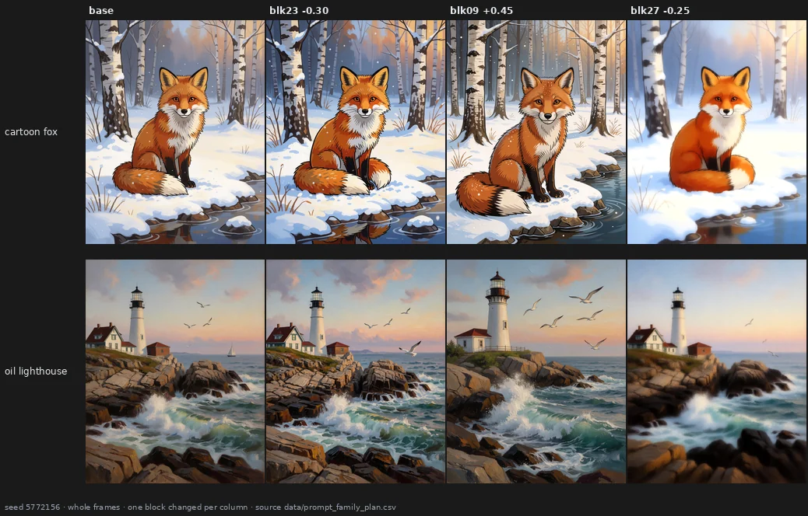

Three blocks, three very different changes: more colour, a more realistic (and different!) scene, a
softer picture. The question behind this whole work is simple: is a change like that a **knob** —
something that does the same thing on any picture, that you can turn up and down — or am I just shaking
the model and seeing what falls out?

Before any of that, I had to trust the instrument. With every value at zero the tuner changes no pixel,
and the same render made again days later is identical to the bit (I checked again before every test in
this report). The one instrument I can't make exact is my own eye: I judge the pictures knowing which
edit made them. That's why every image is published, so anyone can look again.

→ [page 20](20-method.md) · **holds**

---

## 2 · What is inside the model?

Push every block, one at a time, and look. Spoiler: the stack is not 28 copies of the same thing.

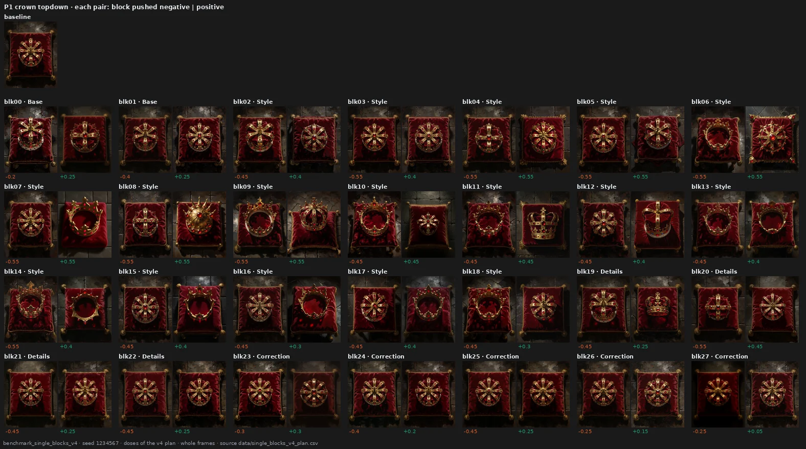

The blocks near the end (21–27) change **properties of the image** — colour, grain, sharpness, softness —
and the crown stays the same crown. The blocks in the middle change **what is depicted**: the crown
becomes an open ring, is seen from the side, turns into another crown. The first two blocks behave like
the last ones, working on grain and detail.

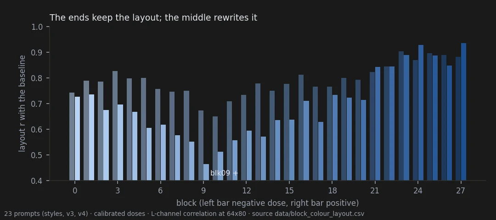

Measured, the same split shows up three times. The end blocks keep the composition; the middle rewrites
it. At equal strength, only the blocks at the two ends are recognisable as themselves on a different
picture, while a middle block does something reproducible on one picture and something else on another.
And by a content measure (DINOv2), the middle blocks are the ones that change the content most. One
caution, though: the end blocks don't change *fewer* rendering statistics — grain moves a lot of them at
once — they change fewer *kinds* of property.

Neighbouring blocks also work in little teams: 08–10, 15–16 and 23–26, pushed up, move the picture the
same way, on two different sets of prompts. And the split is faintly visible in the weights themselves:
the two blocks that rewrite the picture the most, 8 and 9, have the strongest single direction in their
MLP — a result that passed its test by a thin margin.

→ [page 21](21-block-map.md) · map **open**, weights **ambiguous**

---

## 3 · How far can you push?

Not every block can take the same push.

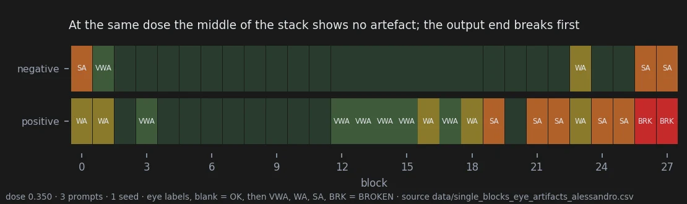

At the same strength, the output end breaks first: pushed up, blocks 26 and 27 destroy the picture, and
most of 19–25 add visible artefacts, while the middle shows nothing at all. That's a **hard limit** — grain,
noise, a mosaic of colour, things anyone recognises as broken.

The middle has another limit, a **soft** one, and it's sneakier. The picture stays clean and well
rendered, but the drawing stops making sense: faces flattened into masks, anatomy undone, objects fused
together. Nothing in it *looks* like an error, so it's the harder one to spot, and no statistic in this
project detects it. Section 11 shows one.

→ [page 21](21-block-map.md#how-far-each-block-can-be-pushed) · **open**, the soft limit is an observation

---

## 4 · Is there a knob that does one thing everywhere?

One block came really close: block 23. Turn it one way and it adds colour; turn it the other way and it
takes colour away.

I tested it on eight new prompts, two seeds each: colour moves the expected way, step by step along the
dose, in 15 of 16 cases, and doubling the dose roughly doubles the effect (×1.76). The obvious alternative
is to write "colorful, vivid highly saturated colors" in the prompt. The words do more... and that's
exactly their problem:

The words redraw the cartoon elf and add a lemon to the still life (nobody asked for a lemon). Where the
block and the words add the same amount of colour, the block leaves the rest of the picture closer to the
original on every measure I tried. Said so, it's a gentle knob: in 9 of 16 cases the words reach more
colour than the block at its strongest tested setting.

→ [page 22](22-saturation-knob.md) · **holds**

---

## 5 · Can one preset give a whole style its look?

If I always start my prompts with "Cartoon style illustration.", can a single preset give everything I
write that way a common look? Six subjects, three styles, two seeds.

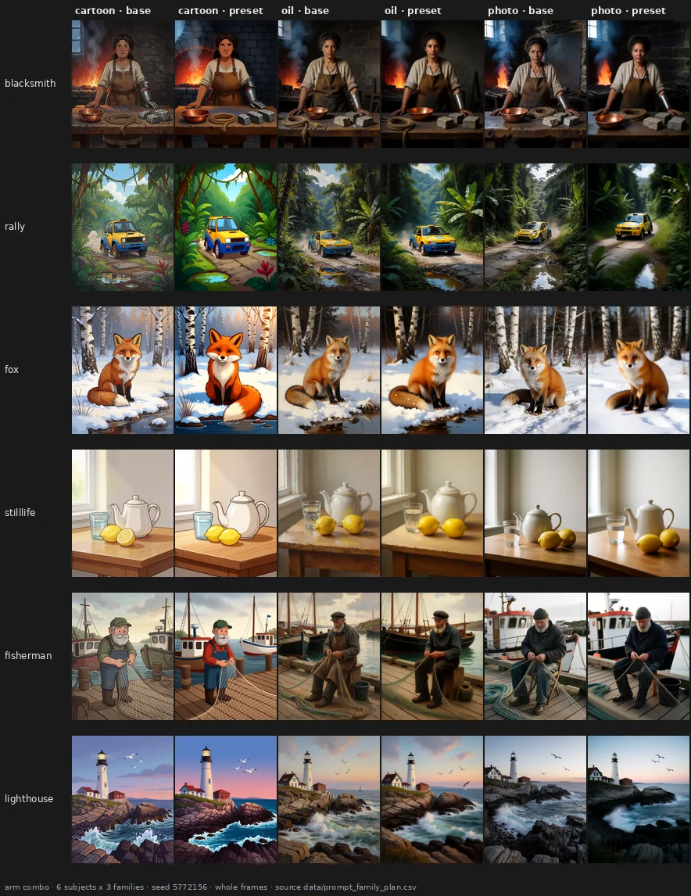

For presets made of end blocks: yes. The change is clearly more alike inside a style than across styles,
and inside a style it keeps about 70% of the agreement it has between two seeds of the same prompt. It
works best on cartoons and worst on photographs.

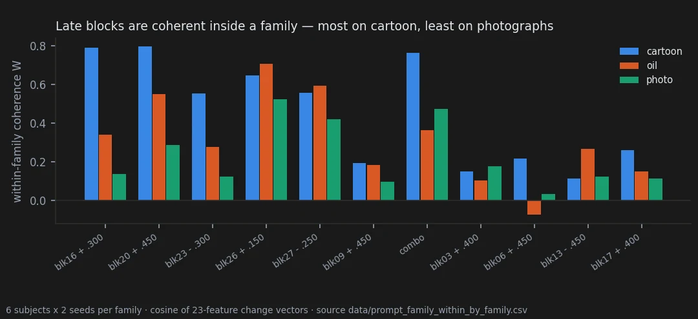

The middle blocks are the interesting case. By eye they also give a style a common change — block 9 makes
everything more realistic — but it's a change of *content*, and none of my measures sees it. And content
can mean identity:

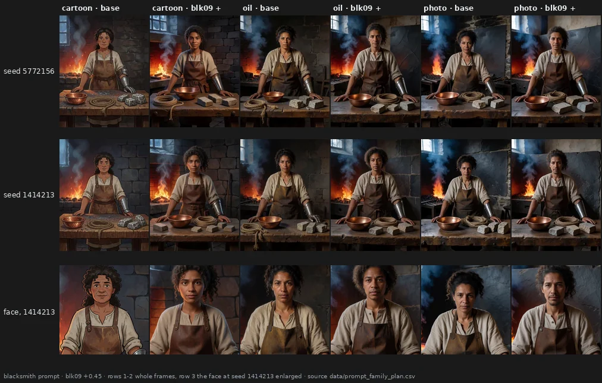

At one seed my female blacksmith stays a woman; at the other, in two styles, she becomes a man — the most
common picture of the word "blacksmith" (dataset bias, hello again). If you need characters that stay the
same across a series of images, that's the risk to test next.

→ [page 23](23-prompt-family-presets.md) · end blocks **holds** · middle blocks **open**

---

## 6 · Can I make my own preset, and does it work on new pictures?

A map is only worth something if someone can actually use it. So I tried, on character portraits. I
looked at what every block does to four drawn characters, then wrote a preset of ten small numbers aiming
at *a more American-comic look leaning toward animation: flat colours and clean lines*. I froze it, and
only then rendered seven characters at four new seeds, with and without it. The halfling, the dragonborn
and the tiefling had never been rendered while I was tuning.

By the numbers, the preset changes the three new characters in a common direction about as coherently as
the four it was tuned on (0.51 against 0.61). But I made it, and I knew which image was which, so the
real test had to be someone else's eye. My partner, who had never seen the project, went through 56
sheets like this one with me out of the room: two versions of one character, in random order, every pair
shown twice with the sides swapped. The question: which one looks more American comic, more animation?

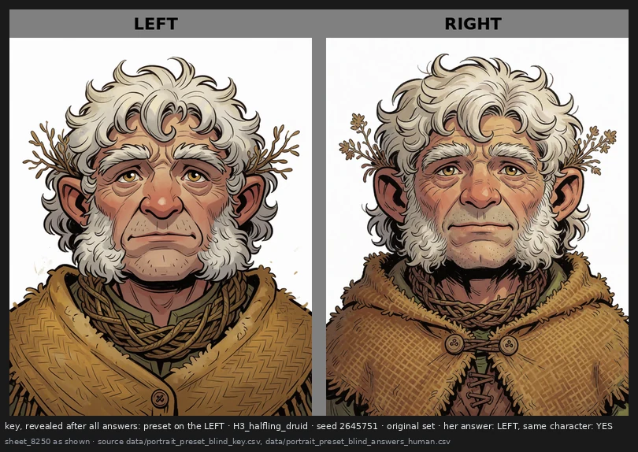

She picked the preset 56 times out of 56, and said "left" exactly half the time: she was reading the
pictures, not the side.

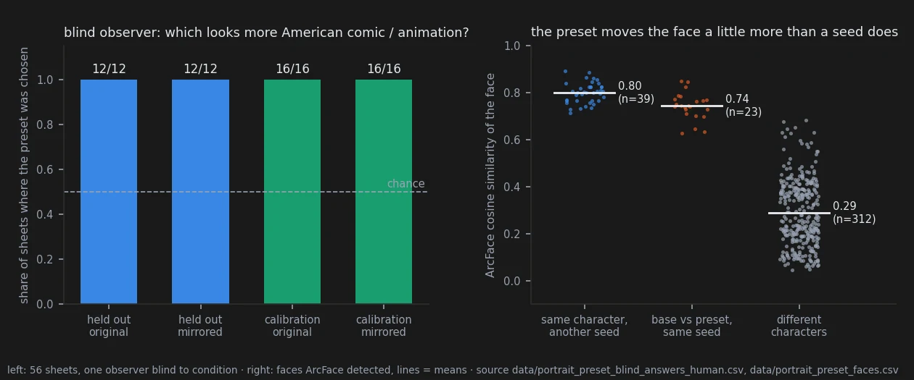

Does the character stay the same? Mostly. A face-recognition network says each face under the preset is
far closer to its own base (0.74) than to any other character (0.29), but a little further than a new
seed moves it (0.80) — so the rule I had set myself, "no more change than a seed", failed. Looking at the
worst cases, nothing is deformed, but the preset can take away things the prompt asked for: a gnome
prompted with wide-eyed curiosity frowns at all three seeds, a half-orc's snarl turns into a stern closed
face, dirt smudges and chalk dust disappear together with the hatching. And a shape the prompt described
can drift: the tiefling was asked for short horns swept flat, and a fancy jacket.

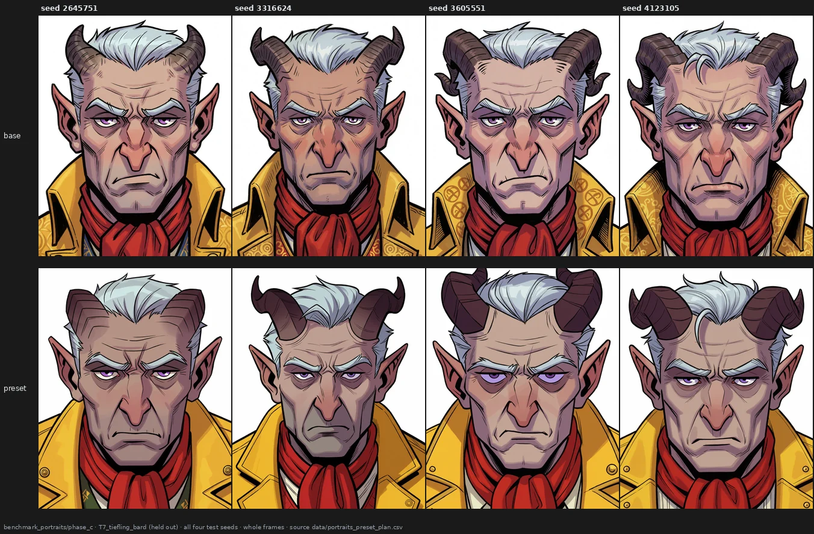

→ [page 28](28-portrait-preset.md) · the look carries over **holds** · the blind observer **holds** ·
face no more changed than by a seed **overturned** · flattened expressions **open**

---

## 7 · Does it matter how I write the prompt?

Same content, written four ways: the original, reordered, as a list of tags, with synonyms.

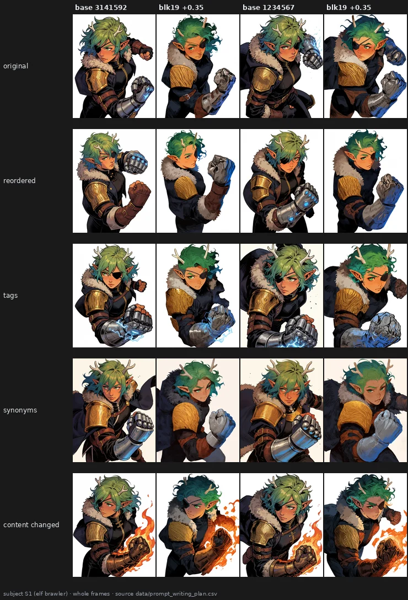

Each writing gives a different pose (order and context bias at work), but the block does the same thing
to all of them. Measured, rewriting the prompt changes what a block does about as much as changing the
seed, and far less than changing the subject. Still, the test was inconclusive by its own rule, because a
small change of content disturbed the block even less than rewriting did — the opposite of what I
expected.

→ [page 24](24-wording.md) · **ambiguous**

---

## 8 · What do standard metrics see?

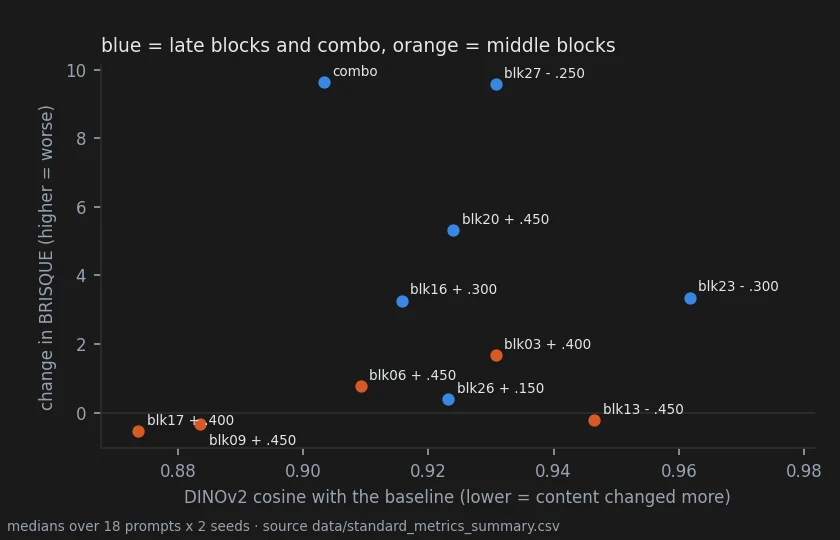

The usual quality and similarity metrics confirm the colour knob, and they put a price tag on presets:
most end blocks cost image quality, while the middle blocks change the content the most and cost nothing
measurable. But they miss two things my eye saw: the noise of block 26, and the common look that middle
blocks give a style. I predicted a content metric would catch the second one. It didn't.

→ [page 25](25-standard-metrics.md) · prediction **overturned**

---

## 9 · What is inside one block?

Every block is made of two parts that work one after the other. The **attention** lets each patch of the
picture look at the others and at the prompt; the **MLP** then reworks each patch on its own. Until then
I had always pushed both together, so I pulled them apart: every block, attention alone and MLP alone,
both directions, on three pictures — a thousand renders. Then I looked at them without knowing which was
which, and wrote down for each one what kind of damage I saw, if any, and how strong it was.

Most of the noise comes from the MLP. Comparing the two halves of the same block, the MLP was the noisier
one in 13 cases, the attention in 2, with 4 ties; the attention joins in only in the very last blocks.
The first block is the odd one out: either half alone wrecks the picture, while both together keep its
composition (though not a clean surface).

Going through those labels, I noticed something else. The edits I had marked as "beautiful for the comic"
were the ones that changed the drawing the *most*: a new pose, a different light, cleaner shading. And
they all came from the middle of the stack. The noisy ones, from the end, changed the drawing much less.
They just dirtied it.

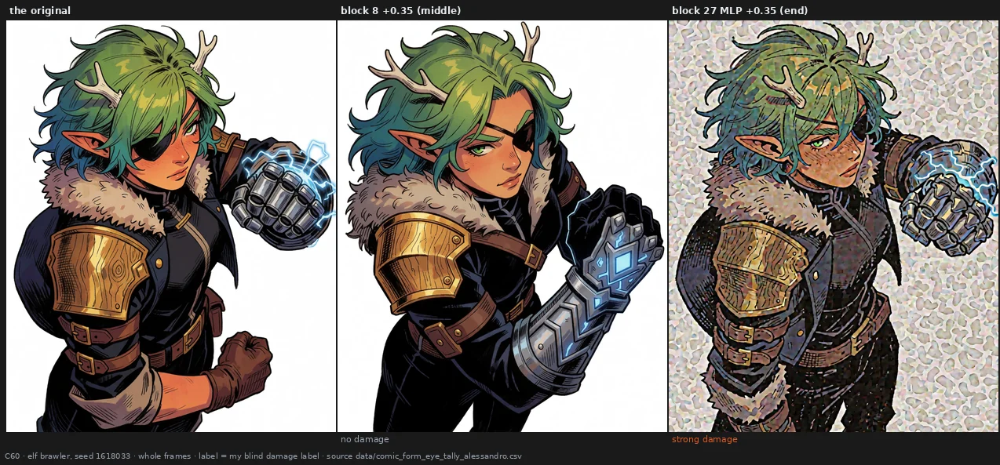

So I tested it properly: ten middle edits and ten end edits, chosen by a fixed rule, on three new
pictures and three new seeds, 180 pairs judged blind. The middle edits changed the picture more, by the
numbers and by eye, and damaged its surface in 19% of the pairs against 79% for the end edits. Well...
19% is not zero. Four of the ten middle edits paid a price on the new pictures — patches in a flat sky,
rectangles in a background. A follow-up on the six that stayed clean couldn't decide whether they're
really free: 4 damaged pairs out of 72, too few to tell.

Last, the old claim that *every* push costs a little fine texture. I tried to overturn it on its own
ground, with new seeds. On its two comic prompts it came back almost to the third decimal; on two
photographs it didn't, because there the last blocks *add* fine detail instead of removing it.

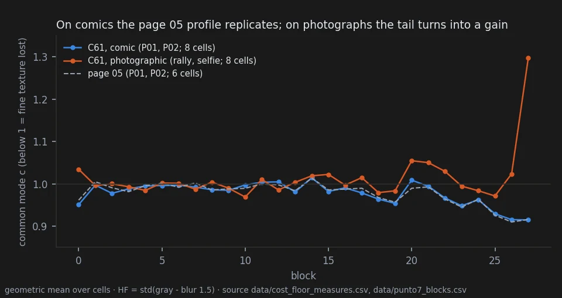

One honest limit runs through all of this: no measure I have sees the noise the way an eye does. I tried
eight of them, tested blind against my labels, and none was good enough. So every statement here about
noise rests on one pair of eyes — mine.

→ [page 29](29-inside-the-block.md) · middle edits change more and damage less **holds** · and are not
free **holds** · the noise lives in the MLP **open** · the cost of every push **ambiguous**

---

## 10 · What happens if you edit the text half?

Before the image model draws a single pixel, a language model reads your prompt and turns it into a long
list of numbers: the *conditioning*. That list is the only thing the image model will ever know about your
words. So, of course, I tried the same trick on it: pick one of its layers and switch off its attention or
its MLP — or double it.

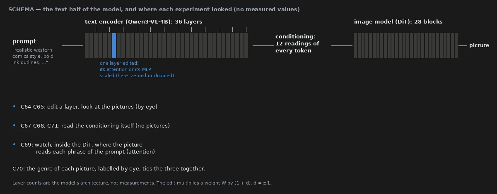

The pictures change a lot, but not the way they do when you push the image model. They don't get noisy:
they change **genre**. A Western comic becomes anime, a cartoon, a children's book... and quite often it
changes *who* is drawn, too. My elf loses her antlers, her pointed ears, her tan skin, sometimes her whole
face.

The destination depends on the character, too: the same edit that scatters my elf between comic and anime
turns a dwarf and a gnome into photographs. Switching off half a layer does little; doubling it does a lot.
Even the word order matters: same edit, same words, different order... different genre.

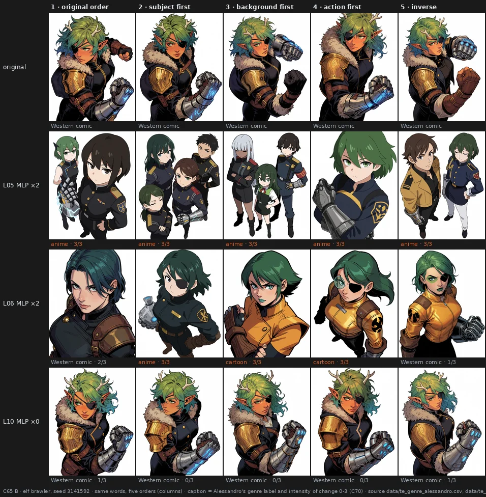

Is any of this predictable? Partly. Measure how far an edit moves the conditioning and you know roughly how
much the picture will change — that held in two tests fixed in advance. The catch, found afterwards: it
mostly tells a strong kind of edit from a mild one. Among the strong edits, the ones that change genre, it
can't tell you which will change the picture more.

The real puzzle was *where* the picture goes. When my elf changed genre, she went to anime 39 times out of
50, and never to a photograph or a painting. Why anime? I tested two ideas, each with its rule written down
before looking.

Idea one: maybe the picture simply stops paying attention to the words "western comics". So I added a probe
that watches where every part of the picture "looks" among the words of the prompt, without changing a
single pixel. One strong edit does lower the attention on the style words... the other one raises it, and
switches genre just as often. Picture by picture, the attention doesn't tell the switched images from the
others.

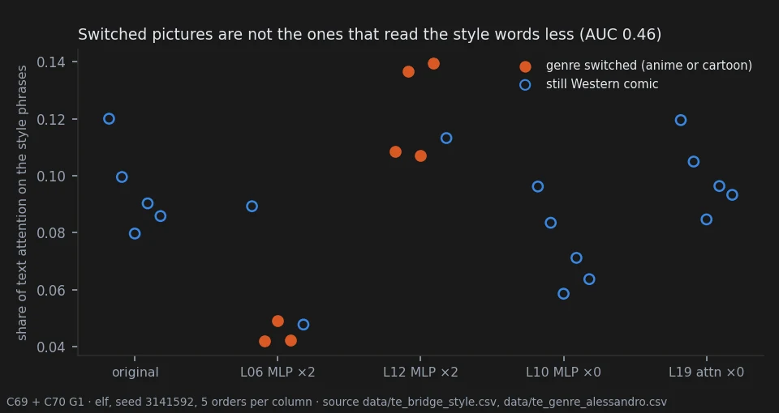

Idea two: maybe the edit pushes the text the way writing "anime style" would. So I encoded the prompt with
"anime style" in place of "western comics style" and compared the two moves. Nothing in common: the edits
push somewhere else entirely, and 5 to 24 times harder than swapping a style word.

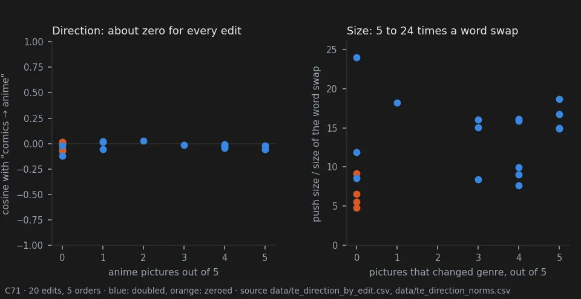

So I stopped guessing and looked. I removed the three words that name the style and kept everything else.
Every single time, the elf came out as anime: same character, same pose, flatter colours, no hatching.
That's where *this* description goes when nothing holds it in a style. (It's not the model's answer to
nothing at all: an empty prompt gave me anime, a photo, anime and a painting.)

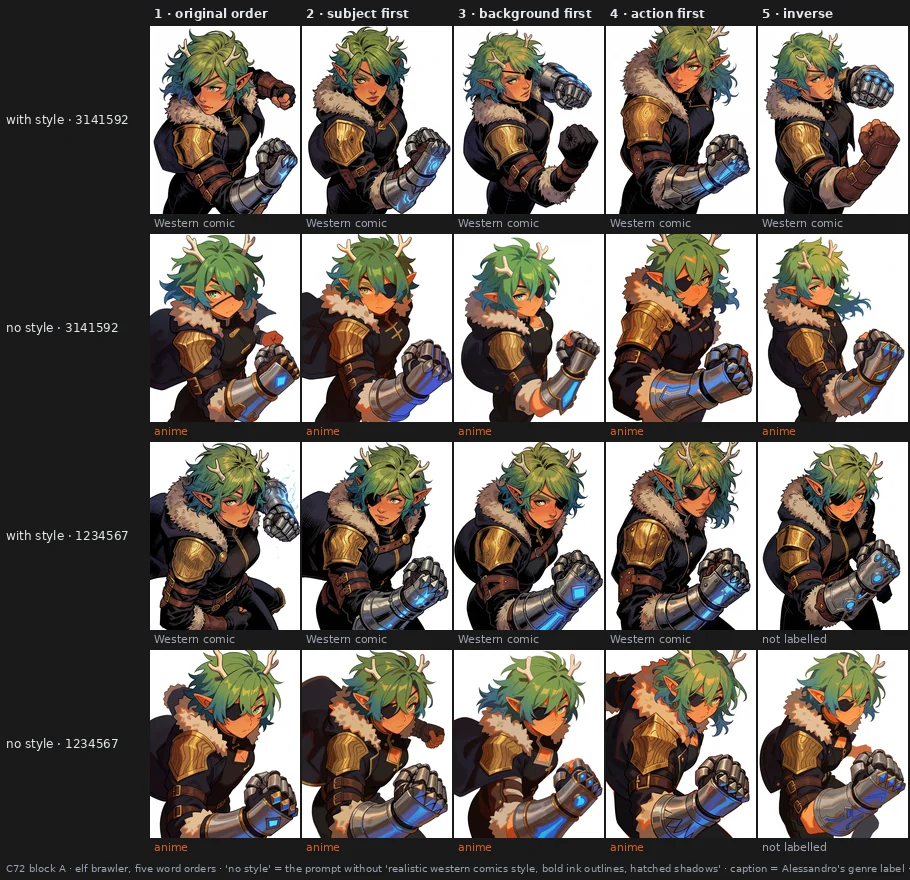

Then the control a reviewer asked for: random pushes on the text, as large as the edits, without touching a
single weight. If the anime were only a matter of "pushing hard enough", random pushes should get there too.
Some do: noise that changes from word to word sends the picture to anime or cartoon about as often as the
edits. But the same random push added equally to every word does... nothing at all. And the real edits are
not random. The one with the largest push keeps the comic every time, where random pushes of the same size
break it almost every time; another one, with a smaller push, turns everything into anime, where random
pushes almost never do. Each edit has a direction of its own.

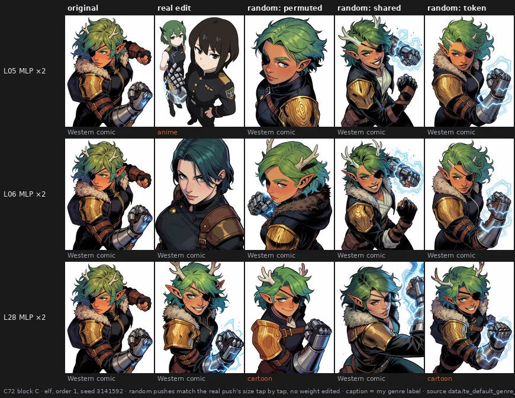

But the elf is one character. So I repeated the "no style" test on seven other portraits, removing only
"Western comics style". Well... they didn't go anime. They came back as paintings or realistic renders — the
same faces, painted by a different hand — and only one picture in 28 was anime. Every character has its own
fallback. And the edits don't lead there either: each edit has a destination of its own, one toward
photographs, one toward cartoons, two that never leave the comic, whoever is drawn.

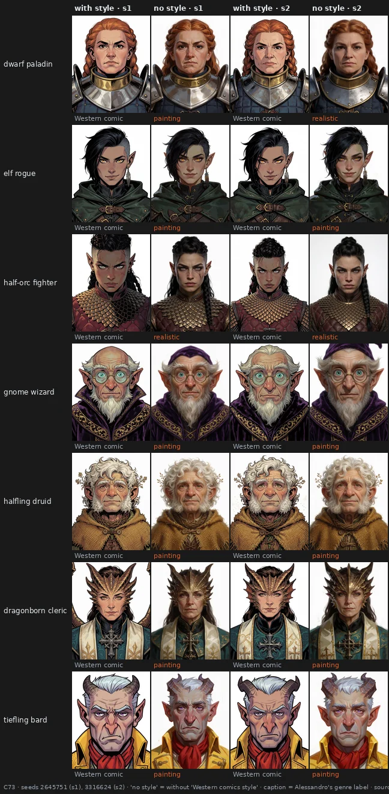

Last, I asked the model to draw each phrase of the prompt on its own, and some answers explained a lot.
"Female dwarf" comes with a beard, every time: so the beard I kept seeing on my dwarf under edits was simply
the model's own idea of a dwarf. "Uniform" is always an anime schoolgirl. And "realistic western comics
style"... draws cowboys. The model reads "western" as the Wild West!

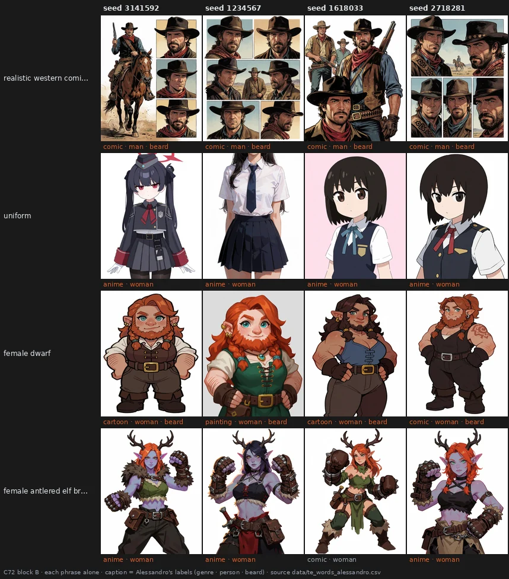

Said so, two warnings. My genre labels are coarse: two pictures I labelled "Western comic" can look nothing alike,
so "no change of genre" doesn't mean "same style". And all these edits were extreme: "doubling" an MLP scales all
three of its matrices, which is far stronger than the word suggests.

So I walked the dose down. Three edits, twelve doses from a tenth of the edit to the full one, three portraits,
two seeds, all compared side by side. First surprise: nothing breaks. Not one picture loses coherence, even at full
dose. Second: the style is stubborn. Below 0.70 nothing changes style at all; then one edit jumps from comic to
photograph in a single step, and another slides slowly toward cartoon.

The third is the one that matters to me. Before the style moves, the character is already gone. My half-orc loses
her tusks, which I asked for, and her pointed ears and grey skin, which the model had chosen, while she is still
drawn as a comic; the elf rogue's dark skin lightens, though I never asked for a skin tone; the control edit, which never touches the style, still dresses the half-orc in a high oriental collar.
And the changes all lean the same way: toward a lighter-skinned, more generic human. For me this is the real damage
of a text-encoder edit: it doesn't break the picture, it makes the model forget what I asked for and fill the gap
with its defaults.

So I tested it blind. Every phrase of the prompt became a yes/no question, asked one at a time over every picture,
with no dose and no edit on screen. The traits fall with the dose, and they go before the style. Then the control I
cared about most: random pushes of the same size, labelled by someone who had never seen these pictures and knew
nothing about what I'm doing. Random pushes keep nine traits in ten. Two of my edits keep half to two thirds. And when
those two change the skin, it goes lighter, 14 times out of 14, while random pushes almost never touch it. The third
edit, L28, keeps the character better than the random pushes do. So it isn't the size of the push: it's where each
edit points.

So, where inside the text encoder does the damage happen? First I just looked, with a probe that reads without
touching anything. One layer does almost all the writing: the MLP of layer 6 takes the encoder's internal signal from
about 400 to about 13,100, and every layer after it adds a few percent. Layer 6 is also the edit that turned my
portraits into photographs. Coincidence? Maybe. It's the next thing I'll test.

Then a detail I had missed: the image model doesn't read only the last layer of the text encoder. It takes **twelve
readings** of every word along the way, at layers 2, 5, 8... up to 35, and mixes them. L28, the edit that keeps the
character, can only reach the last three. So maybe L06 and L14 do their damage through the earlier readings? I let
each edit reach only some readings and kept the others untouched. The readings right after the edited layer: nothing
happens. The early and middle ones cost more traits than the late ones in five cases out of six... by a margin just
short of the bar I had fixed. And the halves don't add up: under L14 the whole edit turns the half-orc into another
person every time, while each half leaves her a half-orc.

Two curiosities to finish. Switch off half of the encoder's very first layer and the image model stops drawing:
it *writes* the prompt, in broken words ("realist: om wetern comips"). Switch off the whole layer and it's just
coloured noise. And people asked me about commas. On two prompts with four characters each, commas, periods,
semicolons, no punctuation at all: no difference. BREAK, the old trick to keep concepts apart, does the opposite of
what it promises here: it breaks the scene in 16 pairs out of 16.

→ [page 30](30-the-text-encoder.md) · the size of the push predicts the change **holds**, mostly between
kinds of edit · these edits change genre and identity more than they damage the surface **holds** · one edit moves every character the same way
**overturned** · the switch comes from less attention on the style words **overturned** · or from a push
toward "anime" **overturned** · without style words the elf falls back to anime **holds** · every character has its own fallback **holds** · edits lead there **overturned** · random
pushes of the same size do it too **ambiguous** (only if they vary across words) · each edit's own direction
decides **open** · along the dose the style moves before the picture breaks, which it never does **holds** · gradually **holds\*** (\*pooled: one edit slides, one jumps) · the character's traits go first **holds** (L06, L14) · and that cost follows each edit's direction, not its size **holds** · dark skin turns lighter under those edits **holds** · the damage doesn't go through the readings right after the edited layer **holds** · it goes through the early and middle ones rather than the late ones **ambiguous** · layer 6 writes almost all of the encoder's signal **open** · half of layer 0 off makes the picture write the prompt **open** · separators make no difference on complex prompts **holds** · BREAK breaks the scene **holds**

---

## 11 · Is an edit a knob you could recognise?

If an edit of the text encoder is going to be a tool, it has to behave like a knob: a shape I can calibrate, the same
effect every time I turn it, a look of its own. So I followed what happens to the conditioning as I turn an edit up,
from a tiny dose to ten times the full one. It doesn't spiral or wave: it bends once near the start and then runs
straight. A random push of the same size bends too, so the bend is the network's; but how much it bends is the edit's,
and on six prompts as different as a comic portrait and a macro leaf it changes by at most 7 degrees. One curve per
edit, whatever the prompt. Drawn for all 35 layers, the deeper ones bend less, and in the first third an edit bends
exactly like a random push: there it has no direction of its own.

On the way I checked a suspicion about L06, the edit that turns portraits into photographs: layer 6 is where a few
entries of the encoder's signal become enormous. Put those entries back and the damage stays; change only them and the
picture comes back. It's not them.

Then a lesson. I pushed edits of different layers to the *same* change of the conditioning, to compare them fairly.
Early layers broke or redrew the picture; deep ones barely touched it. The image model doesn't listen to every part of
the conditioning equally, so from then on I calibrated every edit on the picture itself.

I was convinced that any fixed change of the weights, even a random one, changes a prompt's pictures the same way at
every seed. Claude read the first pictures the other way: three different random pushes seemed to age the paladin all
alike, as if the network chose the direction. Labelled blind, content and style asked apart: one fixed random push
changes the content the same way across seeds almost every time, three different ones mostly don't. Across *different*
subjects the change carries too, but as a family resemblance, "something similar" rather than the same change, and it
crosses from comic portraits to a rally car or a leaf. I asked for that "something similar" answer in the middle of the
pass, and the verdict leans on it.

And then the test I like best, because I proposed it. Five pictures of one prompt: two made with one edit, two with
another at the *same* two seeds, one with a third. The tempting mistake is to pair the pictures that share a seed,
because they share a composition. I found the right groups in 20 of 28 trials, where guessing gets one in 15, and never
grouped by seed: for text-encoder edits, random pushes and my old image-model presets alike. An edit leaves a
signature you can see. One thing I learned on the side: the embeddings we used to measure "the same change" don't see
it; for that, the measure is the eye.

→ [page 31](31-what-an-edit-leaves.md) · an edit's push bends once, the bend the network's and its size the edit's, on any prompt **holds** · deeper layers bend less **holds** · the edit straighter than a random push at every layer **overturned** (only from the middle on) · L06's damage doesn't go through the massive activations **holds** · at equal push on the conditioning, deep edits barely move the picture **open** · deep edits carry a direction of their own **ambiguous** · different random pushes change content differently **ambiguous** (the eye says yes, the embeddings disagree) · across subjects a family resemblance, across style domains too **holds** · the eye sorts pictures by the edit that made them, never by seed **holds** · embedding cosines don't track "the same change" **open**

---

## 12 · What fooled us

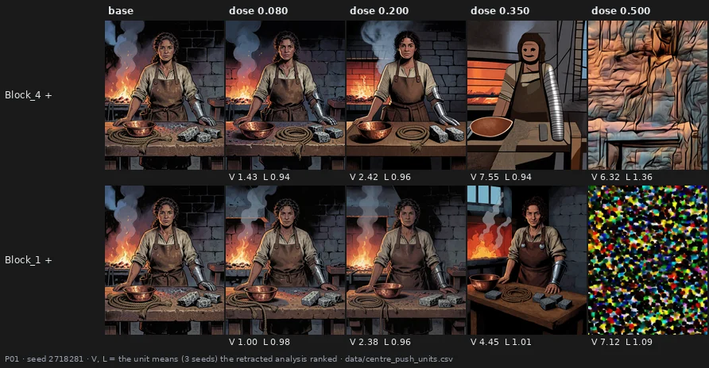

Two statistics once ranked these as the best edits of the whole project: they moved the picture far and
"kept the line". Nobody had opened them. Well... a destroyed picture *is* far from the original, and a
regular texture is "line" everywhere. At 0.350 the faces in the top row are already masks — the soft limit
of section 3. Four claims of this project were withdrawn this way, every one of them made from a statistic
and undone by simply looking. That's why every test in this report puts the eye first.

→ [page 26](26-what-did-not-work.md) · **overturned**, with the limits of the whole report

---

## 13 · Where to start, and what is not known

If you want to try the tuner, start from the map: the end blocks for colour, grain and softness, safe at
small doses; the middle blocks for deeper changes, with care. If the end blocks bring noise, try their
attention alone before giving up on them: most of the noise lives in the MLP. A block-by-block guide,
written by eye and meant to be corrected, is on [page 21](21-block-map.md#a-starting-guide-what-each-block-seems-to-do).

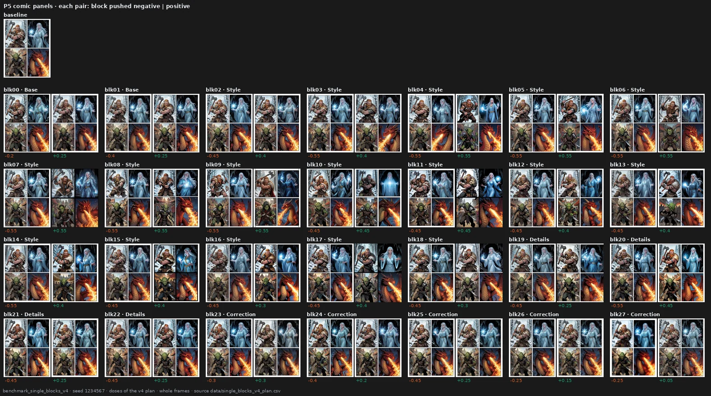

What I don't know yet: whether the clean middle edits are truly free; whether a measure can ever replace
the eye on noise; why each text-encoder edit points where it does, and why two of them wipe out the
character and lighten the skin while a third protects it (the damage needs many of the encoder's readings at once, and
is more than the sum of its halves) (milder doses don't help much: the style holds, but the
character starts going well before); whether a preset can keep a character's expression as well as its identity (the portrait preset
kept who they were, not always how they looked at you); whether a blind observer would still say "same
character" when some sheets show two different ones; whether the noise of a preset can be cleaned
afterwards without losing its look; how much each block writes into the model's internal signal; whether someone who has never seen these pictures would sort them by the edit as I did; and whether any of
this carries over to another model. Keep in mind that all of this is one model, mostly one
observer who knew the conditions (one blind observer for the portraits, and one for the text-encoder control), and samples of 16 to 56 cases
per test.

Other kinds of edit — reordering whole blocks, for instance — are in [appendix A](27-other-edits.md), and
every experiment that led here is in the [exploratory notebook](../notebook/).
